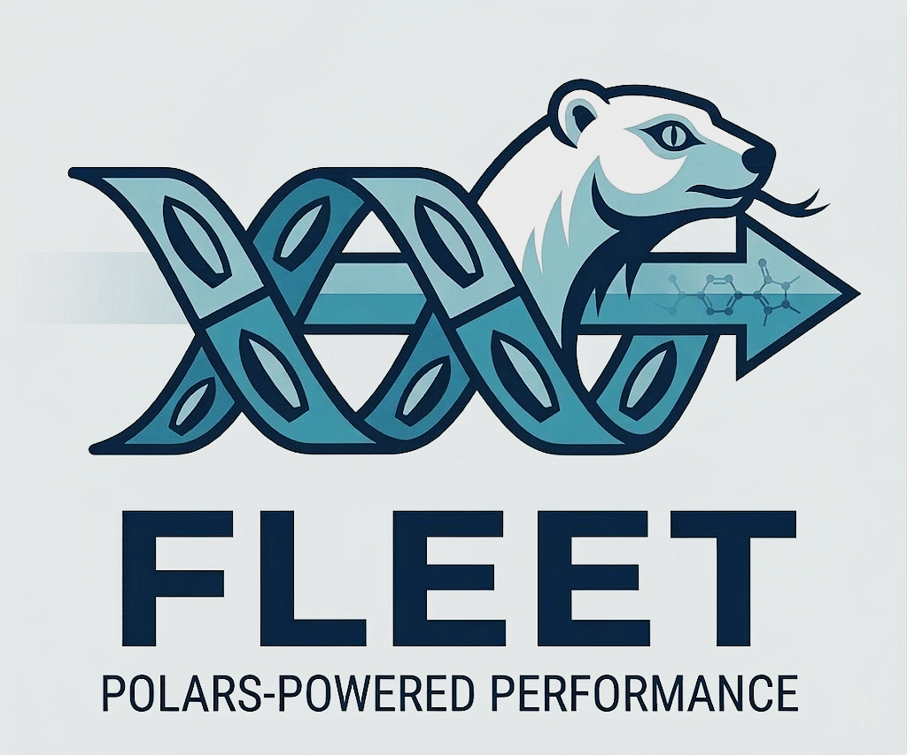

<a id="readme-top"></a>

<!-- PROJECT SHIELDS -->

[![Contributors][contributors-shield]][contributors-url]
[![Forks][forks-shield]][forks-url]
[![Stargazers][stars-shield]][stars-url]
[![Issues][issues-shield]][issues-url]
[![MIT License][license-shield]][license-url]
[![Python 3.12+][python-shield]][python-url]
[![PyPI][pypi-shield]][pypi-url]

<!-- PROJECT LOGO -->
<br />
<div align="center">
  <a href="https://github.com/RealSlimMahdi/fleet-cdisc">
    
  </a>

  <p align="center">
    A minimalistic yet powerful CDISC SDTM/ADaM derivation toolkit built on Polars.
    <br />
    <a href="https://realslimmahdi.github.io/fleet-cdisc/"><strong>Explore the docs »</strong></a>
    <br />
    <br />
    <a href="#quick-demo">Quick Demo</a>
    &middot;
    <a href="https://github.com/RealSlimMahdi/fleet-cdisc/issues/new?labels=bug">Report Bug</a>
    &middot;
    <a href="https://github.com/RealSlimMahdi/fleet-cdisc/issues/new?labels=enhancement">Request Feature</a>
  </p>
</div>

<!-- TABLE OF CONTENTS -->
<details>
  <summary>Table of Contents</summary>
  <ol>
    <li><a href="#about-the-project">About The Project</a></li>
    <li><a href="#built-with">Built With</a></li>
    <li><a href="#quick-demo">Quick Demo</a></li>
    <li>
      <a href="#getting-started">Getting Started</a>
      <ul>
        <li><a href="#prerequisites">Prerequisites</a></li>
        <li><a href="#installation">Installation</a></li>
      </ul>
    </li>
    <li><a href="#namespace-extensions">Namespace Extensions</a></li>
    <li><a href="#usage">Usage</a></li>
    <li><a href="#cli-tooling">CLI Tooling</a></li>
    <li><a href="#project-structure">Project Structure</a></li>
    <li><a href="#roadmap">Roadmap</a></li>
    <li><a href="#contributing">Contributing</a></li>
    <li><a href="#license">License</a></li>
    <li><a href="#acknowledgments">Acknowledgments</a></li>
  </ol>
</details>

---

<!-- ABOUT THE PROJECT -->

## About The Project

Fleet is a **lazy expression accumulator** with an immutable builder API that specializes in creating **CDISC SDTM/ADaM** datasets using [Polars](https://pola.rs) namespace extensions.

Clinical statistical programming often requires hundreds of lines of boilerplate to handle common CDISC requirements — merging controlled terminology, calculating study days, deriving baselines, and maintaining traceability. Fleet solves this by extending Polars with **chainable, domain-specific verbs** that read like a specification.

**Why Fleet?**

- **Intent-driven syntax** — your code reads like the CDISC spec itself
- **Lazy evaluation** — all verbs accumulate into a single Polars `with_columns` pass; nothing runs until `.to_frame()`
- **Zero Pandas** — built entirely on Polars for blazing-fast, multi-threaded execution
- **AI-first design** — structured API surface optimized for LLM-assisted programming
- **Dual workflow** — inline Python pipeline chaining _or_ metadata-driven `define.yaml` approach
- **Seven dependencies** — minimal footprint, maximum capability

<p align="right">(<a href="#readme-top">back to top</a>)</p>

## Built With

[![Polars][polars-badge]][polars-url]
[![Pydantic][pydantic-badge]][pydantic-url]
[![Python][python-badge]][python-url]

<p align="right">(<a href="#readme-top">back to top</a>)</p>

---

## Quick Demo

```python
import fleet
import polars as pl
from codelists import SEX  # generated by: fleet init ct

# SDTM DM domain — from raw data to submission-ready in one chain
dm = (
    raw_df.sdtm
    .hardcode_no_ct("DOMAIN",  value="DM")
    .hardcode_no_ct("STUDYID", value="MYSTUDY01")
    .assign_no_ct("USUBJID",   source="patient_id")
    .assign_ct("SEX", source="sex_raw",
               ct_codelist=SEX, ct_mapping={"M": "M", "F": "F"})
    .assign_dtc("RFSTDTC", source="first_dose_date")
    .to_frame()
)

# ADaM BDS dataset — baseline, change, study day
advs = (
    vs_sdtm.adam
    .source("USUBJID")
    .study_day("ADY", analysis_date="ADT", reference_date="TRTSDT")
    .baseline("BASE", aval="AVAL", baseline_flag="ABLFL")
    .chg("CHG", aval="AVAL", base="BASE")
    .to_frame()
)
```

Nothing runs until `.to_frame()`. All intermediate verbs accumulate into a single optimized Polars pass — no intermediate allocations.

<p align="right">(<a href="#readme-top">back to top</a>)</p>

---

<!-- GETTING STARTED -->

## Getting Started

### Prerequisites

- **Python 3.12+**
- [**uv**](https://docs.astral.sh/uv/getting-started/installation/) — the only supported package manager
- **CDISC Library API key** (optional, for CLI bootstrapping) — get one at [library.cdisc.org](https://library.cdisc.org)

### Installation

**From PyPI (stable)**

```bash
uv add fleet-cdisc
```

**From source (development)**

```bash
git clone https://github.com/RealSlimMahdi/fleet-cdisc.git
cd fleet-cdisc
uv sync --extra docs --extra all --extra dev
```

**Verify**

```bash
python -c "import fleet; print(fleet.__version__)"
```

<p align="right">(<a href="#readme-top">back to top</a>)</p>

---

## Namespace Extensions

<!-- AUTO:NAMESPACES:BEGIN -->

Importing `fleet` registers chainable namespaces on **every** Polars DataFrame. All ADaM namespaces also inherit **13 shared verbs** from the common mixin: `source`, `derivation`, `assigned`, `recode`, `rename`, `condderivation`, `whereclauses`, `merge_adsl`, `derive_dt`, `derive_dtm`, `format_iso`, `flag`, `criterion`.

<details>
<summary><b><code>df.sdtm</code></b> — SDTM domains (14 verbs)</summary>

`assign_no_ct` · `assign_ct` · `assign_dtc` · `hardcode_ct` · `hardcode_no_ct` · `condition_add` · `if_then_else` · `ae_aerel` · `merge` · `remove_dup` · `group_by` · `dataset_level` · `notsubmitted` · `multiple_responses`

</details>

<details>
<summary><b><code>df.adam</code></b> — ADaM BDS (29 verbs: 16 specific + 13 shared)</summary>

**Specific:** `lookup` · `study_day` · `baseline` · `chg` · `pchg` · `bmi` · `nrind` · `on_treatment` · `shift` · `bsa` · `map` · `qtc` · `derive_summary_records` · `derive_locf_records` · `derive_param` · `transform`

**Shared:** `source` · `derivation` · `assigned` · `recode` · `rename` · `condderivation` · `whereclauses` · `merge_adsl` · `derive_dt` · `derive_dtm` · `format_iso` · `flag` · `criterion`

</details>

<details>
<summary><b><code>df.adam.adsl</code></b> — ADSL (20 verbs: 7 specific + 13 shared)</summary>

**Specific:** `first_date` · `last_date` · `duration` · `count_events` · `age_years` · `age_from_dates` · `derive_period`

**Shared:** `source` · `derivation` · `assigned` · `recode` · `rename` · `condderivation` · `whereclauses` · `merge_adsl` · `derive_dt` · `derive_dtm` · `format_iso` · `flag` · `criterion`

</details>

<details>
<summary><b><code>df.adam.occds</code></b> — OCCDS / ADAE, ADCM… (16 verbs: 2 specific + 13 shared + 1 multi-row)</summary>

**Specific:** `treatment_emergent` · `onset_recovery`

**Multi-row:** `seq`

**Shared:** `source` · `derivation` · `assigned` · `recode` · `rename` · `condderivation` · `whereclauses` · `merge_adsl` · `derive_dt` · `derive_dtm` · `format_iso` · `flag` · `criterion`

</details>

<details>
<summary><b><code>df.adam.onco</code></b> — Oncology (18 verbs: 5 specific + 13 shared)</summary>

**Specific:** `aval_resp` · `tumor_response_flag` · `best_overall_response` · `confirmed_response_flag` · `filter_pd`

**Shared:** `source` · `derivation` · `assigned` · `recode` · `rename` · `condderivation` · `whereclauses` · `merge_adsl` · `derive_dt` · `derive_dtm` · `format_iso` · `flag` · `criterion`

</details>

<details>
<summary><b><code>df.adam.ophtha</code></b> — Ophthalmology (18 verbs: 5 specific + 13 shared)</summary>

**Specific:** `etdrs_to_logmar` · `logmar_to_etdrs` · `study_eye` · `affected_eye` · `bcva_criterion`

**Shared:** `source` · `derivation` · `assigned` · `recode` · `rename` · `condderivation` · `whereclauses` · `merge_adsl` · `derive_dt` · `derive_dtm` · `format_iso` · `flag` · `criterion`

</details>

<details>
<summary><b><code>df.adam.peds</code></b> — Pediatrics (19 verbs: 6 specific + 13 shared)</summary>

**Specific:** `age_days` · `age_months` · `age_years` · `corrected_age` · `prematurity_flag` · `bmi_category`

**Shared:** `source` · `derivation` · `assigned` · `recode` · `rename` · `condderivation` · `whereclauses` · `merge_adsl` · `derive_dt` · `derive_dtm` · `format_iso` · `flag` · `criterion`

</details>

<details>
<summary><b><code>df.adam.vaccine</code></b> — Vaccine (18 verbs: 5 specific + 13 shared)</summary>

**Specific:** `fever_flag` · `seroconversion_flag` · `seroresponse_flag` · `aval_adis` · `event_flag`

**Shared:** `source` · `derivation` · `assigned` · `recode` · `rename` · `condderivation` · `whereclauses` · `merge_adsl` · `derive_dt` · `derive_dtm` · `format_iso` · `flag` · `criterion`

</details>

<details>
<summary><b><code>df.adam.metabolic</code></b> — Metabolic (17 verbs: 4 specific + 13 shared)</summary>

**Specific:** `waist_hip_ratio` · `waist_height_ratio` · `body_fat_pct` · `visceral_fat_flag`

**Shared:** `source` · `derivation` · `assigned` · `recode` · `rename` · `condderivation` · `whereclauses` · `merge_adsl` · `derive_dt` · `derive_dtm` · `format_iso` · `flag` · `criterion`

</details>

<details>
<summary><b><code>df.adam.neuro</code></b> — Neuroscience (18 verbs: 5 specific + 13 shared)</summary>

**Specific:** `centiloid` · `mmse_category` · `cdrsob_total` · `moca_category` · `panss_total`

**Shared:** `source` · `derivation` · `assigned` · `recode` · `rename` · `condderivation` · `whereclauses` · `merge_adsl` · `derive_dt` · `derive_dtm` · `format_iso` · `flag` · `criterion`

</details>

<details>
<summary><b><code>df.adam.pk</code></b> — Pharmacokinetics (29 verbs: 15 specific + 13 shared + 1 multi-row)</summary>

**Specific:** `blq_flag` · `blq_impute` · `nominal_time` · `actual_time` · `predose_flag` · `dose_normalized` · `evid` · `mrrlt` · `blqfn` · `log_conc` · `mdv` · `amt` · `cmt` · `avalcat` · `anl_flag`

**Multi-row:** `seq`

**Shared:** `source` · `derivation` · `assigned` · `recode` · `rename` · `condderivation` · `whereclauses` · `merge_adsl` · `derive_dt` · `derive_dtm` · `format_iso` · `flag` · `criterion`

</details>

<!-- AUTO:NAMESPACES:END -->

<p align="right">(<a href="#readme-top">back to top</a>)</p>

---

<!-- USAGE EXAMPLES -->

## Usage

### Code-Driven Pipeline

Build SDTM and ADaM datasets with explicit Python chaining:

```python
import fleet
import polars as pl
from fleet import load_raw_data
from specs.cdiscpilot01.sdtm.codelists import SEX, RACE, ETHNIC

dm_raw = load_raw_data("datasets/cdiscpilot01/raw/dm_raw.csv").collect()

# SDTM DM
dm = (
    dm_raw.sdtm
    .hardcode_no_ct("STUDYID", value="CDISCPILOT01")
    .hardcode_no_ct("DOMAIN",  value="DM")
    .assign_no_ct("USUBJID",   source="patient_number")
    .assign_ct("SEX", source="sex", ct_codelist=SEX,
               ct_mapping={"F": "F", "M": "M"})
    .assign_ct("RACE", source="race", ct_codelist=RACE)
    .assign_dtc("RFSTDTC", source="first_dose_date")
    .to_frame()
)

# ADaM ADSL
adsl = (
    dm.adam.adsl
    .source("STUDYID")
    .source("USUBJID")
    .source("AGE")
    .source("SEX")
    .rename("TRT01P", source="ARM")
    .first_date("TRTSDT", from_dataset=ex, date_col="EXSTDTC")
    .last_date("TRTEDT",  from_dataset=ex, date_col="EXENDTC")
    .duration("TRTDURD", start_date="TRTSDT", end_date="TRTEDT")
    .flag("SAFFL", criteria='pl.col("_EXDOSE_MAX") > 0')
    .to_frame()
)
```

### Spec-Driven Pipeline

Put derivation logic in `define.yaml` and execute in one line:

```yaml
# define.yaml
datasets:
  - name: DM
    variables:
      - name: STUDYID
        derivation:
          algorithm: hardcode_no_ct
          value: "CDISCPILOT01"
      - name: SEX
        derivation:
          algorithm: assign_ct
          source: sex
          ct_codelist: C66731
          ct_mapping: { "F": "F", "M": "M" }
```

```python
dm = dm_raw.sdtm.from_spec("specs/cdiscpilot01/sdtm/define.yaml", dataset="DM").to_frame()
```

_For complete end-to-end examples, see the [examples/](examples/) directory and the [full Guide](GUIDE.md)._

<p align="right">(<a href="#readme-top">back to top</a>)</p>

---

## CLI Tooling

Fleet includes a CLI for bootstrapping studies, generating Define-XML, and managing CDISC validation.

### Bootstrap a New Study

```bash
# 1. Scaffold the study structure
uv run fleet init cfg --study-id CDISCPILOT01 --company "CDISC" \
  --domains DM,AE,VS,EX --adam-datasets ADSL,ADVS,ADAE --root ./my_study

# 2. Generate define.yaml from CDISC Library IG
uv run fleet init define

# 3. Generate codelists.py from define.yaml
uv run fleet init ct
```

### Generate Define-XML 2.1

```bash
uv run fleet define-xml --spec specs/cdiscpilot01/sdtm/define.yaml --output outputs/define_sdtm.xml

# Add --enrich-methods to embed verb / callable docstrings as <MethodDef> elements
uv run fleet define-xml --spec specs/cdiscpilot01/sdtm/define.yaml --output outputs/define_sdtm.xml --enrich-methods
```

### CDISC Rules Engine Validation

```bash
uv run fleet install-engine       # Download the CDISC Rules Engine binary
uv run fleet doctor               # Verify installation health
uv run fleet uninstall-engine     # Remove managed engine
```

### Standalone Codelist Generation

```bash
uv run fleet init-ct --domains DM,AE,VS,EX --output codelists.py
uv run fleet add-ct  --domains LB,CM --output codelists.py   # incremental
```

<p align="right">(<a href="#readme-top">back to top</a>)</p>

---

## Project Structure

```
Fleet/
├── src/fleet/              # Main package
│   ├── __init__.py             # Public API + namespace registration
│   ├── core/                   # StudyContext, exceptions
│   ├── ct/                     # Controlled terminology loader & validator
│   ├── io/                     # Data loading (CSV, XPT, Parquet) & export
│   ├── sdtm/                   # SDTM namespace — 14 derivation verbs
│   ├── adam/                   # ADaM namespace — 22 verbs + TA extensions
│   ├── define_xml/             # Define-XML 2.1 validation & generation
│   └── validation/             # CDISC Rules Engine integration
│
├── datasets/               # Example raw data (CDISCPILOT01)
├── specs/                  # YAML derivation specs per study/domain
├── tests/                  # Pytest test suite
├── examples/               # End-to-end reference pipelines
├── docs/                   # MkDocs Material documentation site
├── scripts/                # Developer utilities (llms.txt builder)
└── pyproject.toml          # Build config & dependencies
```

For detailed module-by-module documentation, see [STRUCTURE.md](STRUCTURE.md).

<p align="right">(<a href="#readme-top">back to top</a>)</p>

---

<!-- ROADMAP -->

## Roadmap

- [x] SDTM namespace with 14 derivation verbs
- [x] ADaM BDS namespace with 22 derivation verbs
- [x] ADSL patient-level namespace
- [x] OCCDS occurrence namespace (ADAE, ADCM)
- [x] Therapeutic area extensions (Oncology, Ophthalmology, Pediatrics, Vaccine, Metabolic, Neuroscience, PK)
- [x] Trial Design Domain support (TE, TA, TV, TS, TI)
- [x] Spec-driven pipeline (`define.yaml` → `from_spec()`)
- [x] CLI bootstrapping pipeline (`fleet init cfg/define/ct`)
- [x] Define-XML 2.1 generation
- [x] CDISC Rules Engine integration
- [x] SAS XPT export
- [ ] Additional ADaM dataset structures (ADTTE, ADPC)
- [ ] Enhanced validation reporting

See the [open issues](https://github.com/RealSlimMahdi/fleet-cdisc/issues) for a full list of proposed features and known issues.

<p align="right">(<a href="#readme-top">back to top</a>)</p>

---

<!-- CONTRIBUTING -->

## Contributing

Contributions are what make the open-source community such an amazing place to learn, inspire, and create. Any contributions you make are **greatly appreciated**.

1. Fork the Project
2. Create your Feature Branch (`git checkout -b feature/AmazingFeature`)
3. Commit your Changes (`git commit -m 'Add some AmazingFeature'`)
4. Push to the Branch (`git push origin feature/AmazingFeature`)
5. Open a Pull Request

Please read [CONTRIBUTING.md](CONTRIBUTING.md) for coding standards and development workflow.

### Development Setup

```bash
git clone https://github.com/RealSlimMahdi/fleet-cdisc.git
cd fleet-cdisc
uv sync --extra docs --extra all --extra dev

# Run tests
uv run pytest

# Lint & format
uv run ruff check
uv run ruff format --check

# Run all example scripts
uv run python examples/full_pipeline_example.py
uv run python examples/cdiscpilot01_inline.py
uv run python examples/cdiscpilot01_spec_driven.py
uv run python examples/adnca_example.py
uv run python examples/tdd_example.py
```

<p align="right">(<a href="#readme-top">back to top</a>)</p>

---

<!-- LICENSE -->

## License

Distributed under the MIT License. See [LICENSE](LICENSE) for more information.

<p align="right">(<a href="#readme-top">back to top</a>)</p>

---

<!-- ACKNOWLEDGMENTS -->

## Acknowledgments

- [Polars](https://pola.rs/) — the blazing-fast DataFrame library that powers Fleet
- [CDISC](https://www.cdisc.org/) — the clinical data standards that Fleet implements
- [Pharmaverse](https://pharmaverse.org/) — inspiration from the R ecosystem, particularly the admiral family of packages
- [Best-README-Template](https://github.com/othneildrew/Best-README-Template) — the template that inspired this README

<p align="right">(<a href="#readme-top">back to top</a>)</p>

---

<!-- MARKDOWN LINKS & IMAGES -->

[contributors-shield]: https://img.shields.io/github/contributors/RealSlimMahdi/fleet-cdisc.svg?style=for-the-badge
[contributors-url]: https://github.com/RealSlimMahdi/fleet-cdisc/graphs/contributors
[forks-shield]: https://img.shields.io/github/forks/RealSlimMahdi/fleet-cdisc.svg?style=for-the-badge
[forks-url]: https://github.com/RealSlimMahdi/fleet-cdisc/network/members
[stars-shield]: https://img.shields.io/github/stars/RealSlimMahdi/fleet-cdisc.svg?style=for-the-badge
[stars-url]: https://github.com/RealSlimMahdi/fleet-cdisc/stargazers
[issues-shield]: https://img.shields.io/github/issues/RealSlimMahdi/fleet-cdisc.svg?style=for-the-badge
[issues-url]: https://github.com/RealSlimMahdi/fleet-cdisc/issues
[license-shield]: https://img.shields.io/github/license/RealSlimMahdi/fleet-cdisc.svg?style=for-the-badge
[license-url]: https://github.com/RealSlimMahdi/fleet-cdisc/blob/main/LICENSE
[python-shield]: https://img.shields.io/badge/python-3.12%2B-blue?style=for-the-badge&logo=python&logoColor=white
[python-url]: https://www.python.org/
[pypi-shield]: https://img.shields.io/pypi/v/fleet-cdisc?style=for-the-badge&logo=pypi&logoColor=white
[pypi-url]: https://pypi.org/project/fleet-cdisc/
[polars-badge]: https://img.shields.io/badge/Polars-CD792C?style=for-the-badge&logo=polars&logoColor=white
[polars-url]: https://pola.rs/
[pydantic-badge]: https://img.shields.io/badge/Pydantic-E92063?style=for-the-badge&logo=pydantic&logoColor=white
[pydantic-url]: https://docs.pydantic.dev/
[python-badge]: https://img.shields.io/badge/Python-3776AB?style=for-the-badge&logo=python&logoColor=white
