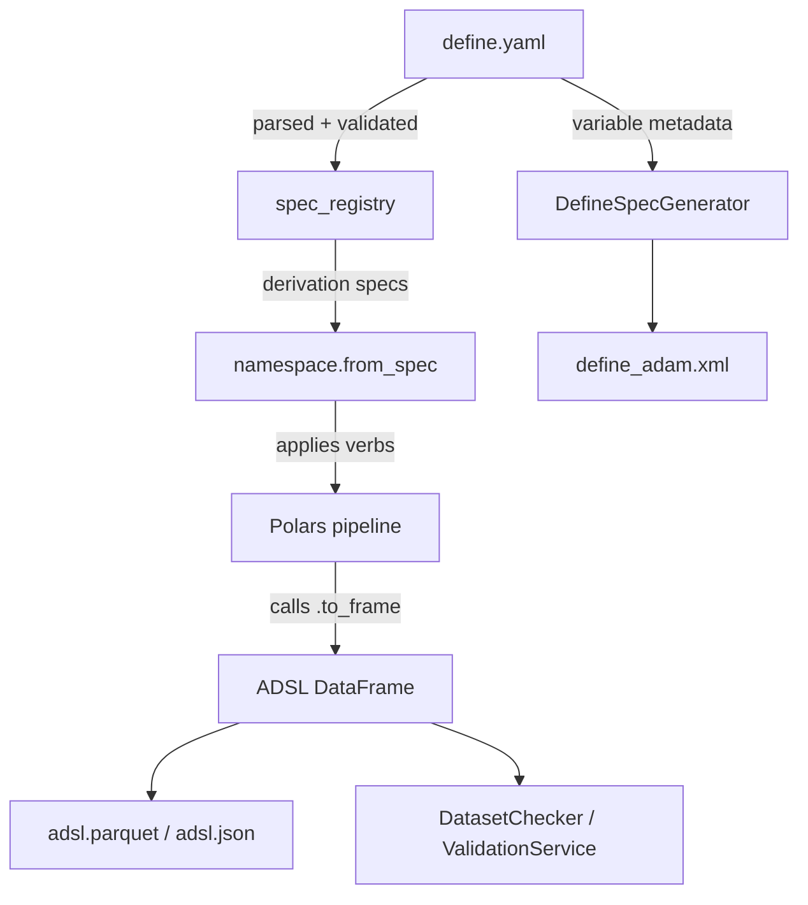

<!--
Runnable examples on this page are executed by tests/unit/test_docs_examples.py.
A fenced python or yaml block is run unless the line immediately before its
opening fence is the HTML comment "docs:no-run" (used for illustrative
fragments that reference files or study data not present in the test harness).
-->

# How `define.yaml` Drives DataFrame Creation

`define.yaml` is the **single source of truth** for a Fleet study. One file simultaneously:

1. Declares all output variables (fed to Define-XML 2.1 generation)
2. Specifies how each variable is derived (executed as a pipeline)
3. Declares codelists and controlled terminology references
4. Defines structural metadata (keys, class, structure label)

---

## File Layout

<!-- docs:no-run -->

```yaml
# yaml-language-server: $schema=../../../src/fleet/define_xml/schemas/define_spec_schema.json
fleet_spec_version: 2
study:
  id:             CDISCPILOT01
  standard:       ADAMIG
  standard_version: "1.1"

codelists:
  - oid: C66731
    name: Sex
    type: text
    items:
      - coded_value: "M"
        decode: MALE
      - coded_value: "F"
        decode: FEMALE

datasets:
  - name: ADSL
    label: Subject-Level Analysis Dataset
    structure: One record per subject
    keys: [STUDYID, USUBJID]
    inputs:
      - name: DM
        type: dataset
    variables:
      - name: STUDYID
        ...
```

The spec is validated against the bundled JSON Schema (`define_spec_schema.json`),
which is **generated from the algorithm registry** — its `algorithm:` enum and
per-algorithm required fields always match what `from_spec()` actually executes
(a CI sync test enforces this). The top-level `fleet_spec_version: 2` pins the
spec dialect; a future incompatible version is rejected with a clear message
rather than silently misinterpreted.

`fleet lsp` reads that schema straight from the installed package, so the
[Fleet VS Code extension](https://github.com/RealSlimMahdi/fleet-vscode) gives
you inline errors with no setup. Without it, a generic YAML language server can
read the same schema from a `$schema` comment — `fleet init define` prints the
exact line, resolved against your install. Adding it *alongside* the Fleet
extension reports every schema error twice, so use one or the other.

---

## Derivation Algorithms

Every spec-executable verb is declared once in the central registry
(`fleet.core.spec_registry`), which derives the `from_spec` executor, the
per-verb validation models **and** the JSON schema from the verb signature.

**The verb is the algorithm** (ADR-0008). A `derivation:` block is the verb
call: the `algorithm:` value is the verb name and the keys are its keyword
arguments. The rule for the programmer: remove `.verb("TARGET", ` and the
last `)`. What stays is the YAML block. Four conversions apply, because YAML
has no Python objects: a Polars expression is an expression string, a frame is
the name of a pinned dataset, a codelist class is its id, and a `@derivation`
object is its registered name or dotted path. One keyword changes its
spelling: `else_` is written `else`.

| Inline call                                                   | Spec block                                                   |
| ------------------------------------------------------------- | ------------------------------------------------------------ |
| `.assign("DOMAIN", value="DM")`                               | `algorithm: assign`, `value: DM`                             |
| `.assign("SEX", source="sex", ct=SEX, ct_map={...})`          | `algorithm: assign`, `source: sex`, `ct_map: {...}`          |
| `.derivation("AVAL", expression="pl.col('vs') * 2")`          | `algorithm: derivation`, `expression: "pl.col('vs') * 2"`    |
| `.derivation(AGEGR1)`                                         | `algorithm: derivation`, `callable: AGEGR1`                  |
| `.first_date("TRTSDT", from_dataset=ex, date_col="EXSTDTC")`  | `algorithm: first_date`, `from_dataset: EX`, `date_col: ...` |
| `.case_when("ARMCD", when=[...], else_="X")`                  | `algorithm: case_when`, `when: [...]`, `else: X`             |
| `.duration("ADY", start="TRTSDT", end="ASTDT")`               | `algorithm: duration`, `start: TRTSDT`, `end: ASTDT`         |
| `.seq("AESEQ", by=["USUBJID"])`                               | `algorithm: seq`, `by: [USUBJID]`                            |

The SEX block gives no `ct:`: it defaults to the `codelist:` of the variable,
so the id is written once. A `ct_map` on a variable with no `codelist:` and no
`ct:` is a load-time error, because a mapping needs a codelist. Validation is
strict in the other direction too: `source` and `value` exclude each other on
`assign`, a `derivation` needs exactly one of `expression` and `callable`, and
a misspelled key is rejected.

A spec written before ADR-0008 (`assign_ct`, `hardcode_no_ct`, `if_then_else`,
`ct_codelist`, `else_value`, `groups`, …) fails at load with a message that
names the fix: `fleet migrate --spec <define.yaml> --write` rewrites the file
line by line and sets `fleet_spec_version: 2`.

The complete, always-current list is one call away (and `df.sdtm.verbs()` /
`df.adam.verbs()` gives the inline counterpart):

```python
import fleet

print(sorted(fleet.spec_algorithms("adam")))
print(sorted(fleet.spec_algorithms("sdtm")))
```

### The verb-coverage matrix

Not every inline verb is spec-expressible. `fleet.spec_coverage()` returns
the verb ↔ YAML keys ↔ required-keys matrix, and `fleet.SPEC_UNSUPPORTED`
is the machine-checked allowlist of verbs that have **no** spec form
(e.g. `transform`, `derive_summary_records`, the TDD `add_*` verbs) — so
"which subset is spec-safe" has a definite answer instead of a guess:

```python
import fleet

matrix = fleet.spec_coverage()  # algorithm ↔ verb ↔ required fields
inline_only = fleet.SPEC_UNSUPPORTED  # {"sdtm": {...}, "adam": {...}}
print(len(matrix), "algorithms;", len(inline_only["adam"]), "adam verbs are inline-only")
```

The answer covers the verbs of `df.sdtm` and `df.adam`. The verbs of the
sub-namespaces (`df.adam.onco`, `df.adam.pk`, `df.adam.occds` and the
others) are inline only in this release, except the dotted algorithms in
`fleet.spec_algorithms("adam")` (`occds.treatment_emergent`). For another
one, use `algorithm: derivation` with `callable:`.

### Study-specific callables (`callable:`)

When no built-in verb fits, point `derivation:` at a registered derivation
name or a fully qualified Python dotted path. The runtime dispatch depends
on the callable's `kind`:

- **`kind="column"`** (zero-arg, returns `pl.Expr`) — stays fully lazy,
  no DataFrame materialisation. It writes the column named as the
  function, so the function name must be the variable name (or the
  expression ends with `.alias("<variable>")`); otherwise `from_spec`
  raises `SpecError`.
- **`kind="frame"`** (receives upstream DataFrame, returns
  `pl.DataFrame`) — the pipeline is materialised at that point, the function
  is called, and the result is wrapped back into the namespace.

```yaml
- name: AGEGR1
  derivation:
    algorithm: derivation
    callable: examples.cdiscpilot01.adam.derivations.AGEGR1
```

Or use the registered short name (if the derivations module was imported):

```yaml
- name: AGEGR1
  derivation:
    callable: AGEGR1 # algorithm: derivation injected automatically
```

### Derivations folder convention

`fleet derivation add AGEGR1 --dataset ADSL` scaffolds a derivation file
under the study's configured programs tree:

```
programs/derivations/       # <programs dir from study_config.yaml>
    __init__.py
    AGEGR1.py
    BMI.py
```

The convention is **shared across standards** — a `callable:` block works
identically in SDTM and ADaM specs, because both dispatch through the same
core registry and resolver. The resolver itself does no folder scanning: a
callable is found either (a) by short name, when its module has been imported
and the function is `@derivation`-registered, or (b) by fully qualified
dotted path. Declare `derivations_module:` at the top of the spec and
`from_spec()` imports it for you, so short names always resolve. The module
is study Python that runs: `from_spec()` and `fleet define-xml` print one
line on stderr (`# fleet: importing study code derivations_module '...'`)
when they import it.

Both `algorithm:` and `callable:` plug into the Define-XML methods:
`DefineSpecGenerator(spec)` (or `fleet define-xml`) emits one `<MethodDef>` per
**Derived** variable, named `Algorithm for <VARIABLE>`. The
`<Description>` is submission text, resolved in this order:

1. the variable's **`comment:`** — always wins;
2. for `callable:` derivations, the **study callable's docstring**
   (`@derivation` objects use their own `fn` docstring) — this is
   study-authored text; reST markup is stripped;
3. the registry's **submission-facing template** for the algorithm,
   with the spec params filled in (e.g. `chg` renders
   `Change from baseline: AVAL - BASE.`).

Fleet's *verb docstrings* are never used — they are API documentation,
identical across studies and unstable across Fleet versions. The
`<FormalExpression Context="Python/Fleet">` carries the faithful call
(the verb the algorithm runs plus the spec params, or the callable's
`dotted_path`), giving a verifiable link between the regulatory
submission and the exact code that produced the data. The verb is named
after the public namespace class it runs on, the way the run's lineage
records it in `VariableNode.method`, so an ADaM `study_day` reads
`fleet.adam.namespace.AdamNamespace.duration('ADY', end='ASTDT', start='TRTSDT')`
in the define and in the lineage of the dataset it documents. The path is
importable and does not change when Fleet moves a verb between its
internal mixins.

With no `comment:`, the template text of `case_when` reads each branch as
"if <condition> then <value>", and an expression (`flag` criteria,
`derivation` expression) stays verbatim. `fleet define-xml` warns for each
variable whose method text holds a Polars expression: add a `comment:` in
words for the reviewer.

### Example — TRTSDT (date of first dose)

`first_date` is a real spec algorithm — this example runs end to end. In the
spec, `from_dataset:` names a **pinned dataset** (attach it with `.pin("EX", ex)`
before calling `from_spec`); the runtime resolves the name to the pinned frame.

```yaml
fleet_spec_version: 2
study:
  id: CDISCPILOT01
  standard: ADAMIG
  standard_version: "1.1"
datasets:
  - name: ADSL
    label: Subject-Level Analysis Dataset
    structure: One record per subject
    keys: [STUDYID, USUBJID]
    variables:
      - name: TRTSDT
        label: Date of First Exposure to Treatment
        type: date
        origin: Derived
        derivation:
          algorithm: first_date
          from_dataset: EX
          date_col: EXSTDTC
          # admiral template exposure rule: a placebo dose of 0 counts. The SAP decides.
          where: >-
            (pl.col("EXDOSE") > 0) | ((pl.col("EXDOSE") == 0)
            & pl.col("EXTRT").str.to_uppercase().str.contains("PLACEBO"))
```

Run it by pinning `EX` and calling `from_spec` (the harness writes the YAML above
to `define.yaml` first):

```python
import polars as pl
import fleet  # noqa: F401

dm = pl.DataFrame({"STUDYID": ["CDISCPILOT01"] * 2, "USUBJID": ["S1", "S2"]})
ex = pl.DataFrame(
    {
        "USUBJID": ["S1", "S1", "S2"],
        "EXTRT": ["XANOMELINE", "XANOMELINE", "XANOMELINE"],
        "EXSTDTC": ["2014-01-05", "2014-01-02", "2014-02-01"],
        "EXDOSE": [54.0, 0.0, 54.0],  # the 0-dose active row is filtered out by where=
    }
)

adsl = dm.adam.pin("EX", ex).from_spec("define.yaml", dataset="ADSL").to_frame()
print(adsl)  # TRTSDT = 2014-01-05 for S1 (earliest dosed date), 2014-02-01 for S2
```

The equivalent hand-written pipeline calls the same verb directly:

<!-- docs:no-run -->

```python
treated = (
    '(pl.col("EXDOSE") > 0) | '
    '((pl.col("EXDOSE") == 0) & pl.col("EXTRT").str.to_uppercase().str.contains("PLACEBO"))'
)
adsl = dm.adam.adsl.first_date(
    "TRTSDT", from_dataset=ex, date_col="EXSTDTC", where=treated
).to_frame()
```

### Record filters — `row_steps:`

A step that removes records has no variable, so it does not sit in
`variables:`. It sits in the dataset key `row_steps:`, in pipeline order
(ADR-0034). Each step names the variable it follows with `after:` (`null`:
before the first variable), and `from_spec()` runs it right after that
variable. `whereclauses` keeps the records where `where:` is true; `nodup`
keeps one record per `subset:` after the sort on `order_by:`.

```yaml
datasets:
  - name: ADSL
    row_steps:
      - algorithm: whereclauses
        where: ARMCD != "SCRNFAIL"
        after: ARMCD
    variables:
      - name: ARMCD
        derivation: {algorithm: assign}
```

`to_spec_yaml()` writes these steps from an inline chain. A step it cannot
write (a `pl.Expr` filter, `derive_param`) is written as `algorithm: TODO`
with the verb name: `from_spec()` refuses the file until you write the step.
Define-XML shows the steps as the dataset comment.

A variable block with `algorithm: whereclauses` or `group_by` still runs, but
the variable name becomes an ItemDef that no dataset holds, so `from_spec()`
and `fleet define-xml` warn: move the filter to `row_steps:`.

---

## End-to-End Flow



### Running the full pipeline programmatically

`from_spec` is the execution entry point. Pin any datasets the spec references
by name, then build each dataset:

<!-- docs:no-run -->

```python
import polars as pl
import fleet  # noqa: F401

dm = pl.read_parquet("outputs/sdtm/dm.parquet")
ex = pl.read_parquet("outputs/sdtm/ex.parquet")

adsl = (
    dm.adam.pin("EX", ex)
    .from_spec("examples/cdiscpilot01/adam/define.yaml", dataset="ADSL")
    .to_frame()
)
```

`StudyContext` (via `load_study_context(config_path)`) resolves the configured
`raw_data`, `sdtm_data`, `adam_data`, and `metadata` directories so you don't
hard-code paths; it exposes `sdtm_spec` / `adam_spec` / `raw_file(...)` helpers.

### Generating Define-XML from the same spec

One CLI command — inside a study workspace, spec and output default from
`study_config.yaml`:

```bash
uv run fleet define-xml --standard adam                 # config-based defaults
uv run fleet define-xml -s specs/define.yaml -o out.xml --strict
```

The same generation from Python:

<!-- docs:no-run -->

```python
from fleet import DefineSpecGenerator

DefineSpecGenerator("examples/cdiscpilot01/adam/define.yaml").generate(
    "outputs/cdiscpilot01/define_adam.xml"
)
```

`DefineSpecGenerator` emits a `<MethodDef>` per **Derived** variable (see
the method text rule above); variables with `origin: Collected`,
`Assigned`, `Protocol`, or `Predecessor` never reference a method. Generated
documents are validated on the way out — against the vendored CDISC XSDs
*and* a semantic lint (`fleet.define_xml.semantic_errors`) that rejects
reviewer-facing defects such as a `MethodOID` on a non-Derived variable or
API markup inside `TranslatedText`; `validate_xml=False` bypasses both.

### Define-XML gaps: warning or refusal

Define-XML 2.1 requires three things that a spec can leave out:

- a `MethodOID` on each Derived `ItemRef`, so a Derived variable needs a
  `comment:` or a `derivation:` block that gives method text;
- a `Length` on `text`, `integer` and `float` items (characters for text,
  digits for numbers);
- a `SignificantDigits` on `float` items (`significant_digits:` in the spec,
  on a variable or on a value-level entry).

The generator names each gap, one line per item:

```text
specs/define.yaml: 2 Define-XML gap(s):
  DM.SAFFL: no method text (add a comment: or a derivation: block)
  VS.AVAL (PARAMCD = SYSBP): no SignificantDigits (required on float)
```

| Entry point | A gap gives |
| --- | --- |
| `fleet define-xml`, `DefineSpecGenerator(spec)` | the file, and one warning with the list |
| `fleet define-xml --strict`, `DefineSpecGenerator(spec, strict=True)` | `SpecError`, exit code 1, no file |
| `fleet check` | a FAIL row `define (sdtm)` or `define (adam)` with the list |

The schema refuses `significant_digits:` on a type other than `float`, and
`length:` on `date` and `datetime`.

The spec keys below apply to every generation:

- **`fleet_spec_version: 2`** — spec dialect version (checked on load; 2 is the verb vocabulary of ADR-0008, `fleet migrate --spec` rewrites a version 1 file).
- **`derivations_module:`** — a dotted module that `from_spec` imports itself, so
  `callable:` derivations register without a manual import.
- **`output_format:`** — per-dataset or spec-level export format (`parquet`,
  `dataset-json`, `xpt`) recorded in the DAG and Define-XML leaf hrefs, and
  the format `fleet run` writes when no `--format` is given.
- **`output:`** — per-dataset Define-XML leaf href, used verbatim. It names
  the leaf only: `fleet run` still writes `<name>.<ext>` and warns when the
  two differ.
- **`sdtm_role:`** — per-variable SDTM role (`Identifier`, `Topic`,
  `Timing`, `Grouping Qualifier`, `Result Qualifier`, `Synonym Qualifier`,
  `Record Qualifier`, `Variable Qualifier`, `Rule`), written as the ItemRef
  `Role`. `fleet init define` fills it from the CDISC Library; check a
  sponsor-specific role by hand (ADR 0042). It is apart from `role:
  qualifier`, which marks a Non-Standard Variable for `SUPP<domain>` (see
  *Supplemental qualifiers* below).
- **`value_level:`** — value-level metadata entries emitted as Define-XML
  `<ValueListDef>` / where-clause elements.
- **`ct: {validate: true, file: ...}`** — opt the spec into CT validation
  (see below).

---

## Codelist References

Variables can reference codelists declared in the `codelists` block:

```yaml
- name: SEX
  label: Sex
  type: text
  codelist: C66731 # references the oid in codelists[]
  derivation:
    algorithm: assign
    source: SEX
```

The terms of a codelist decide its Define-XML form:

- every term has a `decode:`: `CodeListItem`;
- no term has a `decode:` (units, test codes): `EnumeratedItem`;
- some terms have a `decode:` and some do not: a `SpecError` that names the
  codelist and the first term without one;
- `external: {dictionary: MedDRA, version: "26.0"}` in place of `items:`:
  `ExternalCodeList`.

`nci_code:` on a codelist or a term writes the NCI `Alias`, and
`extended: true` on a term marks a sponsor term (`def:ExtendedValue="Yes"`).
A codelist whose `oid` is an NCI code (`C66731`) gets
`def:StandardOID="STD.CT"` when `study.ct_version` is set; `standard_oid:`
sets another declared standard (`STD.CT.ADAM` with `study.adam_ct_version`).

<!-- docs:no-run -->

```yaml
codelists:
  - oid: C66731
    name: Sex
    type: text
    nci_code: C66731
    items:
      - { coded_value: F, decode: Female, nci_code: C16576 }
      - { coded_value: X, decode: X, extended: true }
  - oid: CL.UNIT
    name: Unit
    type: text
    items: [{ coded_value: mg }, { coded_value: kg }]
```

Each dataset variable has its own `ItemDef` (`IT.ADSL.AGE`, `IT.ADAE.AGE`), so
each one keeps the type, length, origin and codelist of its own dataset.

### Controlled terminology in the spec path

A spec step and its inline call check the same terms. Inside a study, the
`ct:` ID of an `assign`, or the `codelist:` of its variable when `ct:` is
absent, resolves to the class of that ID in the study's `codelists.py`, the
module `fleet init ct` generates. So this entry:

<!-- docs:no-run -->

```yaml
- name: AESEV
  codelist: C66769
  derivation:
    algorithm: assign
    source: ae_severity
```

runs as `.assign("AESEV", source="ae_severity", ct=AESEV)` with the `AESEV`
class of `codelists.py`, and a raw `Mild` gives the same warning in both
notations:
`AE.AESEV: column 'ae_severity' contains values not in codelist 'C66769': ['Mild']`.

- The study is the first `study_config.yaml` above the folder of the
  `define.yaml`, never the working directory.
- When the spec's `ct: file:` (below) or the CT loaded in
  `fleet.get_validator()` holds the codelist, it checks the values in both
  notations. A constant (`assign` with `value:`) is checked against the
  same terms as a column: the loaded CT, then the study class.
- Outside a study, before `fleet init ct`, or for an ID without a class,
  only the loaded CT can check the values.

Because both notations then trust `codelists.py`, Fleet checks the file
against the study:

| Check | Problem | Fix |
| --- | --- | --- |
| Package | A package in the `__ct_packages__` or `__ct_package__` marker of the file (for older files, the package in each class's `_cdisc_url`) is not pinned in `study_config.yaml` (`ct.package`, `ct.adam_package`). | `fleet init ct --force` |
| Mixed packages | The classes name two packages of one product, for example two SDTM CT dates. An SDTM and an ADaM package together are correct. | `fleet init ct --force` |
| Missing codelist | A `codelist:` or `ct:` ID of a `define.yaml` has no class in the file. | `fleet add-ct --domains AE` (SDTM); `fleet init ct --force` (ADaM), after you set `ct.adam_package` |
| Missing file | The `define.yaml` files reference codelists, but the file does not exist. | `fleet init ct` |

`from_spec` warns once per process about all but the missing codelist, and
still checks the values against the file. An inline `ct=` class from another
package gives the package warning too. `fleet check` fails on all four, and
`fleet doctor` prints one `codelists.py` line.

### Two CT packages: SDTM CT and ADaM CT

CDISC publishes ADaM CT on its own dates, and some codelists are only in
ADaM CT (DTYPE, C81224). A study with ADaM datasets pins both packages in
`study_config.yaml`:

```yaml
ct:
  package: sdtmct-2023-12-15
  adam_package: adamct-2023-06-30
```

- `fleet init cfg` and `fleet new` with ADaM datasets pin
  `adamct-2023-06-30`, the latest ADaM CT package on or before the default
  SDTM package. With another `--package`, give `--adam-package` too.
- `fleet init ct` takes each codelist from the first pinned package that
  holds it, SDTM CT first. When no pinned package holds a codelist, it names
  the ID, writes no file and exits with code 1.
- `fleet init ct` also writes the terms and decodes (the NCI preferred term)
  into each `codelists:` entry of the `define.yaml` files that has no terms
  yet; with `--force`, into every entry. The file is rewritten, so only its
  header comment stays. A Define-XML `CodeList` needs its terms, and
  `fleet define-xml` names each codelist without them.
- The ADaM `define.yaml` states both dates: `ct_version` (SDTM CT, for SEX)
  and `adam_ct_version` (ADaM CT, for DTYPE). Its Define-XML lists two CT
  standards, with the publishing sets SDTM and ADaM.

### Opting the spec into CT validation

Without a top-level `ct:` block, an `assign` with a codelist and without
`ct_map` checks its values (pass-through), and one with `ct_map` maps them
without a check. Add a top-level `ct:` block to check every `assign` with a
codelist, mapped ones included; out-of-codelist values emit a warning
naming the dataset, variable, and codelist:

<!-- docs:no-run -->

```yaml
ct:
  validate: true
  file: ct/cdisc_ct.yaml   # optional — loaded for this spec only, also without validate:
datasets:
  - name: DM
    variables:
      - name: SEX
        codelist: C66731
        derivation:
          algorithm: assign
          source: sex
```

When datasets are checked with `DatasetChecker(spec, check_ct=True)`, the values
are also verified against the spec's own inline `codelists:`, and codelist
lookups are normalised to concept IDs — so a spec cannot ship values that
contradict the conformance it asserts in the generated Define-XML.

---

## Schema Validation — What, When, and How

Fleet has two independent layers of schema validation for `define.yaml`. They run at different
points and catch different classes of error.

### Layer 1 — Registry model validation (pipeline-build time)

When you call `.from_spec()`, Fleet resolves each variable's `algorithm:` through
the spec registry and validates its `derivation` block against a **discriminated-union
Pydantic model** generated for that algorithm. The model declares exactly which
fields are required and sets `extra="forbid"`, so a misspelled field is a loud
error — not a silent column of nulls. This runs **immediately when `.from_spec()`
is called**, before any data is materialised.

What it catches:

- Unknown algorithm names (with a did-you-mean suggestion)
- Misspelled or unexpected fields (`extra="forbid"`)
- Missing required fields for a given `algorithm`
- Wrong field types (e.g. a list where a string is expected)

Errors are wrapped in a `SpecError` that names **file → dataset → variable**.
Here is the real message for a typo'd key (`ct_mp` instead of `ct_map`):

<!-- docs:no-run -->

```python
# derivation block with a typo:
#   - name: SEX
#     codelist: C66731
#     derivation:
#       algorithm: assign
#       source: sex
#       ct_mp: {"F": "F"}         # ← typo: should be ct_map

dm = raw_df.sdtm.from_spec("specs/define.yaml", dataset="DM")
# fleet.core.exceptions.SpecError:
# specs/define.yaml → dataset DM → variable SEX: 1 validation error for SDTMAssignSpec
# ct_mp
#   Extra inputs are not permitted [type=extra_forbidden, input_value={'F': 'F'}, input_type=dict]
```

(Note: an `assign` with a codelist id that no loaded CT holds does **not**
error — it copies the value through and emits a `UserWarning` that CT could
not be validated. `assign` never fabricates a missing-field error for an
optional key.)

### Layer 2 — Define-XML generation in strict mode (`fleet check`)

`fleet check` generates the Define-XML of every define.yaml the study config
points at, in strict mode, and writes no file. The row passes only when the
generator gives a valid document. This layer fires **on demand**, not
automatically during pipeline execution.

```bash
uv run fleet check
```

What it catches:

- a spec that does not conform to `define_spec_schema.json` (`SpecSchemaError`,
  with the path of the bad entry);
- a `codelist:` reference to a codelist that the spec does not declare;
- a key, a value-level variable or a where-clause variable that its dataset
  does not declare, and a `crf_pages` document that `study.documents` does
  not declare;
- in an SDTMIG 3.4 (or earlier) spec, a `role: qualifier` variable that
  cannot move to its generated `SUPP<domain>` (see *Supplemental qualifiers*
  below). The message names `SUPP<domain>` and the reason;
- a `study.ct_version` (or `adam_ct_version`) that is not the date of the CT
  package that `study_config.yaml` pins;
- a Define-XML gap: method text, `Length` or `SignificantDigits` (see
  *Define-XML gaps* above);
- a generated document that fails the CDISC XSDs or the semantic lint.

`fleet check` imports no study code: it does not import the
`derivations_module` of the spec, and a `callable:` derivation is described
by its `comment:` or its dotted path. `fleet define-xml` imports the module to
write the method text of each `callable:`.

The derivation blocks themselves are checked by layer 1: the verb's model
knows the required keys, so there are no separate per-algorithm rules.

The same check from Python: `DefineSpecGenerator(path, strict=True).to_xml_string()`
raises on the first of these problems and returns the XML text otherwise.

### When to run each layer

| Layer              | When it fires                             | Blocks execution?                                    |
| ------------------ | ----------------------------------------- | ---------------------------------------------------- |
| Registry models    | Automatically on `.from_spec()` call      | Yes — raises `SpecError` (file → dataset → variable) |
| `fleet check`      | Manually or in CI, before submission      | Yes — a FAIL row and exit code 1                     |
| CDISC Rules Engine | Manually, after datasets are materialised | No — report only                                     |

### JSON Schema & Editor Support

The YAML spec is validated against the bundled schema at:

```
src/fleet/define_xml/schemas/define_spec_schema.json
```

This schema is **generated from the algorithm registry** — its `algorithm:`
enum, per-algorithm required fields, and the `fleet_spec_version` /
`derivations_module` properties are derived from the same declarations that
drive execution, and a CI test fails if the checked-in schema drifts. So the
editor red-squiggles you see match exactly what `from_spec()` will accept —
including the `callable` escape hatch and every algorithm the engine can run.
Regenerate it after registry changes with:

```bash
uv run python -m fleet.define_xml.schema_builder
```

Add this comment to the top of every spec file to activate YAML language-server auto-complete in
VS Code or any LSP-enabled editor:

<!-- docs:no-run -->

```yaml
# yaml-language-server: $schema=../../../src/fleet/define_xml/schemas/define_spec_schema.json
```

---

## Supplemental qualifiers

An SDTM variable with `role: qualifier` (or `algorithm: nsv`) is a
Non-Standard Variable. `fleet run` builds it, then moves it to a
`SUPP<domain>` dataset (SDTMIG 3.4 section 8.4) and writes the parent
without it. IDVAR is `<domain>SEQ`; only DM may have no IDVAR, so another
domain with no `--SEQ` stops the run. Later datasets of the same run still
read the qualifier from the full frame.

The same define.yaml gives the Define-XML. For SDTMIG 3.4 or earlier,
`fleet define-xml` and `fleet check` leave the qualifier out of the parent
ItemGroupDef and add a `SUPP<domain>` ItemGroupDef (ADR 0044):

- the variables STUDYID, RDOMAIN, USUBJID, IDVAR, IDVARVAL, QNAM, QLABEL,
  QVAL, QORIG and QEVAL, with the keys STUDYID, RDOMAIN, USUBJID, IDVAR,
  IDVARVAL and QNAM;
- value-level metadata on QVAL: one where clause `QNAM EQ <name>` per
  qualifier, with its label, type, length, codelist, origin and method;
- IDVAR text `<domain>SEQ` (for DM: null), the rule of `fleet run`;
- the leaf `supp<domain>` in the format of the parent.

<!-- docs:no-run -->

```yaml
- name: AE
  variables:
    - name: AESEQ
      # ...
    - name: AETRTEM
      label: Treatment Emergent Flag
      type: text
      length: 1
      origin: Derived
      role: qualifier  # fleet run: SUPPAE; define: IG.SUPPAE, QVAL where QNAM EQ AETRTEM
      derivation:
        algorithm: assign
        source: trtem
```

The define refuses a qualifier that cannot move: the parent has no STUDYID
or USUBJID, a parent other than DM has no `<domain>SEQ`, the spec also
declares `SUPP<domain>`, the name has more than 8 characters (QNAM), the
label has more than 40 characters (QLABEL), or the qualifier is a key of the
parent. Give CRF pages of a qualifier with `crf_pages:` on the variable: a
key `AE.AETRTEM` in an external page map does not reach `SUPPAE`.

---

## CRF Page References

Variables with `origin: Collected` can include page references to the annotated
Case Report Form PDF. Fleet emits these as `<def:DocumentRef>` /
`<def:PDFPageRef>` elements inside `<def:Origin>` in the Define-XML, and
the standard `define2-1.xsl` stylesheet renders them as clickable links.

!!! note "One origin vocabulary"

    `origin:` uses the Define-XML 2.1 Origin Types — `Collected`,
    `Derived`, `Assigned`, `Protocol`, `Predecessor` — and the same
    values flow into `QORIG` in generated SUPPQUAL datasets. Collected
    values also carry `def:Source`, which defaults to `Investigator`
    (CRF data); override it with `origin_source: Vendor | Sponsor |
    Subject`. The Define-XML 2.0 spellings `CRF` and `eDT` are not valid.

How the Origin **description** renders, per origin type:

- **`Predecessor`** requires `predecessor: DATASET.VARIABLE` (schema-enforced);
  the define renders `Predecessor: DM.COUNTRY`. In an ADaM spec, a variable
  carried with `algorithm: assign` and `source:` but still marked `Collected`
  triggers a generation-time warning suggesting the Predecessor form. When
  freezing an inline pipeline, `to_spec_yaml(dataset="ADSL", predecessor="DM")`
  pre-fills these entries for carry-through columns and pure copies of a
  column present at the start of the chain. A column a verb added with no
  lineage (`merge`) gets a TODO stub, never a Predecessor. The emitted YAML
  stays the explicit, reviewable source of truth.
- **`Derived`** describes the derivation in its `MethodDef`.
- **`Assigned` / `Protocol`** show the `comment:` — e.g.
  `comment: DM.ARM` renders `Assigned: DM.ARM`.
- **`Collected`** with CRF pages renders the page links; Investigator-collected
  variables without pages fall back to a `Case Report Form` description.
- A variable with value-level metadata and no `comment:` renders
  `See Value Level Metadata`.

```yaml
- name: COUNTRY
  label: Country
  type: text
  origin: Predecessor
  predecessor: DM.COUNTRY
```

### Setup: declare the aCRF document

Scaffold the block with one command (config-context: it edits the study's
own define.yaml; `--standard adam|both` covers the ADaM spec too):

```bash
uv run fleet add-acrf --href blankcrf.pdf
uv run fleet add-acrf --href blankcrf.pdf --page-map acrf_pages.yaml --standard both
```

Which adds a `documents` block to the `study:` section:

```yaml
study:
  id: CDISCPILOT01
  standard: SDTMIG
  standard_version: "3.4"
  documents:
    annotated_crf:
      href: blankcrf.pdf # path in the submission package
      title: Annotated Case Report Form # displayed in Define-XML
```

This emits the top-level `<def:AnnotatedCRF>` container and the
`<def:leaf>` element that the XSLT needs to render document links.

### Layer 1 — Simple page strings (most common)

Add `crf_pages` to any collected variable:

```yaml
variables:
  - name: SEX
    label: Sex
    type: text
    origin: Collected
    crf_pages: "8" # single page
    derivation:
      algorithm: assign
      source: sex
      ct: C66731

  - name: RACE
    label: Race
    type: text
    origin: Collected
    crf_pages: "8 9" # space-separated multiple pages
```

The string value maps directly to the `PageRefs` attribute with
`Type="PhysicalRef"`. A number (`crf_pages: 8` in YAML) is read as the page
string `"8"`. Without `study.documents.annotated_crf`, the pages cannot be
written: Fleet gives a warning that names each variable.

A value-level variable takes its own pages: the key of its page map entry is
`DATASET.VARIABLE.<where values>` (for example `LB.LBORRES.ALB`), and the
parent `DATASET.VARIABLE` is the fallback.

### Layer 2 — Rich references (named destinations, page ranges)

For PDF bookmarks or page ranges, use the dict form:

```yaml
- name: SEX
  origin: Collected
  crf_pages:
    pages: "DM_SEX" # PDF bookmark name
    type: NamedDestination # or PhysicalRef (default)

- name: RACE
  origin: Collected
  crf_pages:
    pages: "8 9"
    type: PhysicalRef
    first_page: "8" # optional range attributes
    last_page: "9"
```

`doc:` names the `href` of the annotated CRF or of a supplemental document.
A `doc:` that matches no declared document stops generation with a
`SpecError` that names the variable.

### Layer 3 — External page map (EDC-driven workflows)

For studies where CRF annotations are extracted from an EDC system, point
to an external YAML file:

```yaml
study:
  documents:
    annotated_crf:
      href: blankcrf.pdf
      page_map: acrf_pages.yaml # relative to the define.yaml directory
```

The page map file uses `DOMAIN.VARIABLE` keys:

```yaml
# acrf_pages.yaml — auto-generated from EDC export
DM.SEX: "7"
DM.BRTHDTC: "8"
AE.AETERM: "12 13"
VS.VSTESTCD: "20"
```

Inline `crf_pages` on individual variables always take precedence over the
external page map. A `page_map` file that does not exist stops generation
with a `SpecError`. Page map keys that match no variable of the spec give one
warning that lists them.

### Supplemental documents

Additional supporting documents (reviewer's guide, protocol, etc.) can be
declared alongside the annotated CRF:

```yaml
study:
  documents:
    annotated_crf:
      href: blankcrf.pdf
    supplemental_docs:
      - id: LF.ReviewerGuide
        href: reviewers-guide.pdf
        title: Reviewer's Guide
```

These emit `<def:SupplementalDoc>` and corresponding `<def:leaf>` elements.

---

## Tips

- The `inputs` block declares which upstream datasets the pipeline should join/merge.
- Variables with no `derivation` block are expected to flow in via the `source` dataset — they appear in Define-XML as `origin: Collected`.
- Run `uv run fleet check` (or `fleet define-xml --strict`) to catch schema errors and Define-XML gaps before submission.
