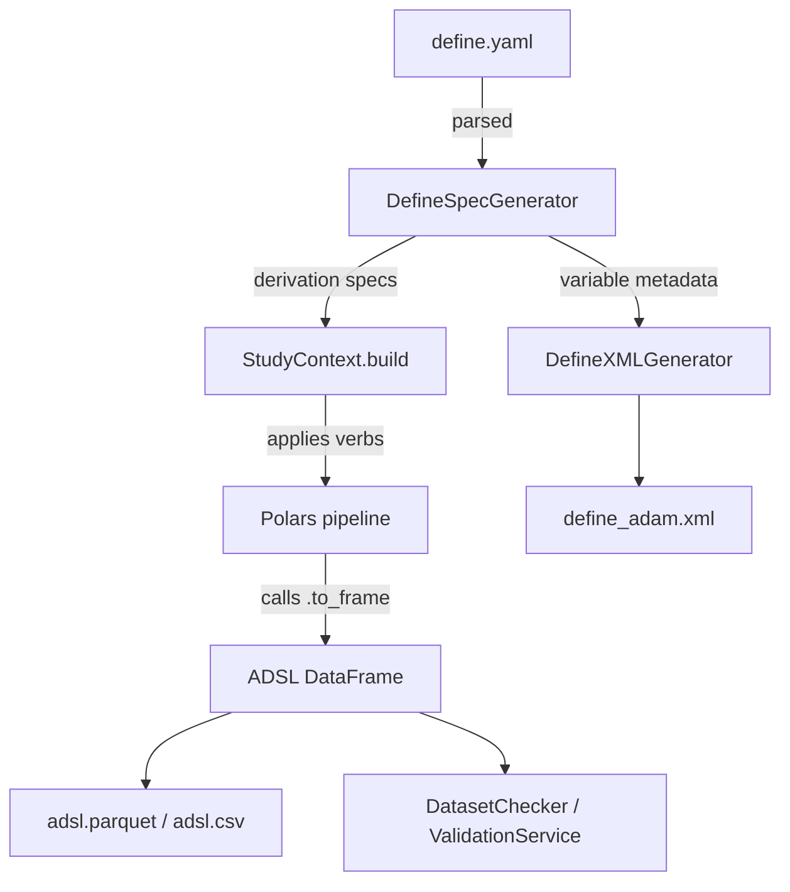

# How `define.yaml` Drives DataFrame Creation

`define.yaml` is the **single source of truth** for a Fleet study. One file simultaneously:

1. Declares all output variables (fed to Define-XML 2.1 generation)
2. Specifies how each variable is derived (executed as a pipeline)
3. Declares codelists and controlled terminology references
4. Defines structural metadata (keys, class, structure label)

---

## File Layout

```yaml
# yaml-language-server: $schema=../../../src/fleet/define_xml/schemas/define_spec_schema.json
study:
  id:             CDISCPILOT01
  standard:       ADAMIG
  standard_version: "1.1"

codelists:
  - oid: C66731
    name: Sex
    type: text
    items:
      - coded_value: "M"
        decode: MALE
      - coded_value: "F"
        decode: FEMALE

datasets:
  - name: ADSL
    label: Subject-Level Analysis Dataset
    structure: One record per subject
    keys: [STUDYID, USUBJID]
    inputs:
      - name: DM
        type: dataset
    variables:
      - name: STUDYID
        ...
```

The schema is validated by the bundled JSON Schema (`define_spec_schema.json`), which means editors with YAML language server support provide auto-complete and inline error highlighting.

---

## Derivation Algorithms

Each variable's `derivation.algorithm` maps directly to an `.adsl` (or `.adam`) verb:

| `algorithm`  | Namespace verb                                                   | What it does                    |
| ------------ | ---------------------------------------------------------------- | ------------------------------- |
| `assigned`   | `.assigned(target, value=...)`                                   | Constant literal for all rows   |
| `source`     | `.source(target, from_col=...)`                                  | Copy column from predecessor    |
| `derivation` | `.derivation(target, expression=...)`                            | Arbitrary Polars expression     |
| `first_date` | `.first_date(target, from_dataset=..., date_col=..., where=...)` | Earliest event date per subject |
| `last_date`  | `.last_date(...)`                                                | Latest event date per subject   |
| `duration`   | `.duration(target, start_date=..., end_date=...)`                | Integer day count               |
| `flag`       | `.eligibility_flag(target, criteria=...)`                        | `"Y"` / `null` flag             |
| `count`      | `.count_events(target, from_dataset=..., where=...)`             | Integer event count             |

### Example — TRTSDT (date of first dose)

In `define.yaml`:

```yaml
- name: TRTSDT
  label: Date of First Exposure to Treatment
  type: date
  origin: Derived
  derivation:
    algorithm: first_date
    from_dataset: EX
    date_col: EXSTDTC
    where: 'pl.col("EXDOSE") > 0'
```

Equivalent hand-written pipeline:

```python
adsl = (
    dm_sdtm.adsl
    ...
    .first_date("TRTSDT", from_dataset=ex_sdtm,
                date_col="EXSTDTC",
                where='pl.col("EXDOSE") > 0')
    ...
    .to_frame()
)
```

---

## End-to-End Flow



### Running the full pipeline programmatically

```python
from fleet import load_study_context

ctx = load_study_context("specs/cdiscpilot01/adam/define.yaml")

# Build every dataset declared in the spec
adsl = ctx.build("ADSL")   # returns a polars.DataFrame
advs = ctx.build("ADVS")
```

### Generating Define-XML from the same spec

```python
from fleet import DefineXMLGenerator

gen = DefineXMLGenerator("specs/cdiscpilot01/adam/define.yaml")
gen.write("outputs/cdiscpilot01/define_adam.xml")
```

---

## Codelist References

Variables can reference codelists declared in the `codelists` block:

```yaml
- name: SEX
  label: Sex
  type: text
  codelist: C66731 # references the oid in codelists[]
  derivation:
    algorithm: source
    source: SEX
```

Fleet threads CT validation through the pipeline automatically — invalid values raise a `CTError` at runtime.

---

## JSON Schema & Editor Support

The YAML spec is validated against the bundled schema at:

```
src/fleet/define_xml/schemas/define_spec_schema.json
```

Add this comment to the top of every spec file to activate YAML language-server auto-complete in VS Code or any LSP-enabled editor:

```yaml
# yaml-language-server: $schema=../../../src/fleet/define_xml/schemas/define_spec_schema.json
```

---

## Tips

- The `inputs` block declares which upstream datasets the pipeline should join/merge.
- Variables with no `derivation` block are expected to flow in via the `source` dataset — they appear in Define-XML as `origin: CRF`.
- Run `fleet validate-spec specs/cdiscpilot01/adam/define.yaml` (CLI forthcoming) or call  
  `DefineValidator("...").validate()` to catch schema errors before running.
