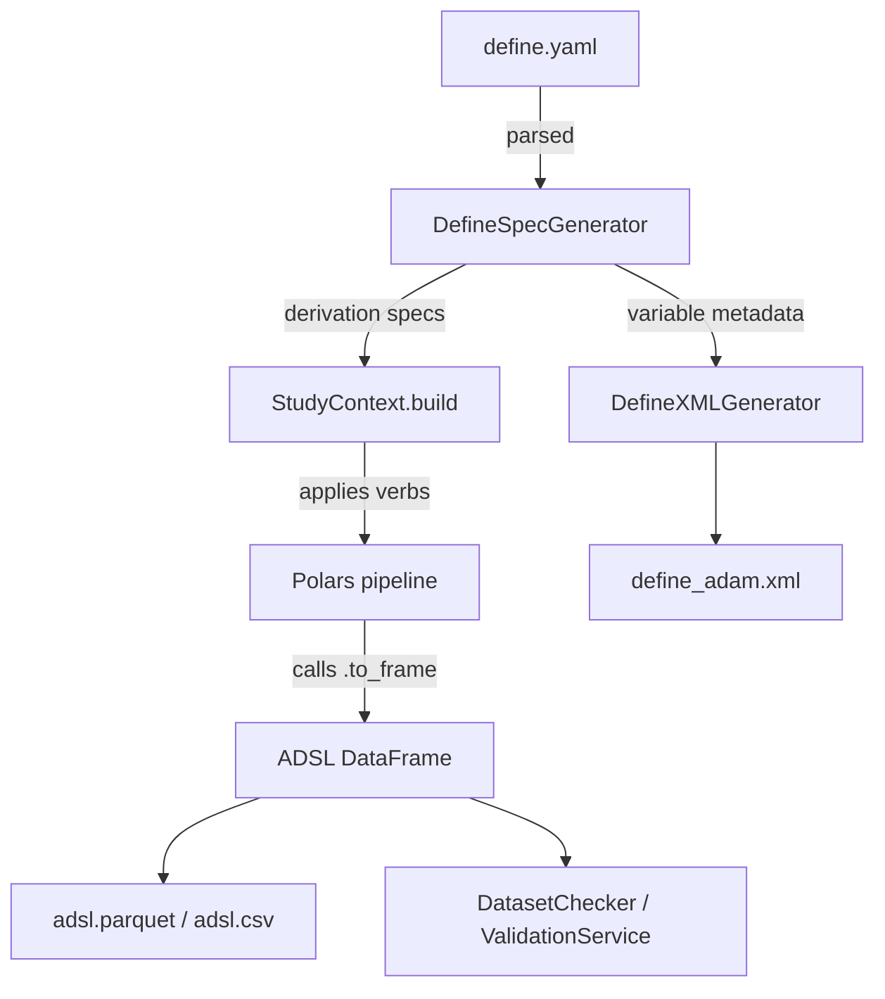

# How `define.yaml` Drives DataFrame Creation

`define.yaml` is the **single source of truth** for a Fleet study. One file simultaneously:

1. Declares all output variables (fed to Define-XML 2.1 generation)
2. Specifies how each variable is derived (executed as a pipeline)
3. Declares codelists and controlled terminology references
4. Defines structural metadata (keys, class, structure label)

---

## File Layout

```yaml
# yaml-language-server: $schema=../../../src/fleet/define_xml/schemas/define_spec_schema.json
study:
  id:             CDISCPILOT01
  standard:       ADAMIG
  standard_version: "1.1"

codelists:
  - oid: C66731
    name: Sex
    type: text
    items:
      - coded_value: "M"
        decode: MALE
      - coded_value: "F"
        decode: FEMALE

datasets:
  - name: ADSL
    label: Subject-Level Analysis Dataset
    structure: One record per subject
    keys: [STUDYID, USUBJID]
    inputs:
      - name: DM
        type: dataset
    variables:
      - name: STUDYID
        ...
```

The schema is validated by the bundled JSON Schema (`define_spec_schema.json`), which means editors with YAML language server support provide auto-complete and inline error highlighting.

---

## Derivation Algorithms

Each variable's `derivation.algorithm` maps directly to an `.adsl` (or `.adam`) verb:

| `algorithm`  | Namespace verb                                                   | What it does                    |
| ------------ | ---------------------------------------------------------------- | ------------------------------- |
| `assigned`   | `.assigned(target, value=...)`                                   | Constant literal for all rows   |
| `source`     | `.source(target, from_col=...)`                                  | Copy column from predecessor    |
| `derivation` | `.derivation(target, expression=...)`                            | Arbitrary Polars expression     |
| `first_date` | `.first_date(target, from_dataset=..., date_col=..., where=...)` | Earliest event date per subject |
| `last_date`  | `.last_date(...)`                                                | Latest event date per subject   |
| `duration`   | `.duration(target, start_date=..., end_date=...)`                | Integer day count               |
| `flag`       | `.flag(target, criteria=...)`                                    | `"Y"` / `null` flag             |
| `count`      | `.count_events(target, from_dataset=..., where=...)`             | Integer event count             |

### Study-specific callables (`callable:`)

When no built-in verb fits, point `derivation:` at a fully qualified Python
callable instead. The callable must be importable at generation time and
takes the upstream DataFrame as its first argument:

```yaml
- name: AVAL
  derivation:
    callable: specs.cdiscpilot01.adam.derivations.derive_aval
```

Both `algorithm:` and `callable:` plug into Define-XML method enrichment:
running `DefineSpecGenerator(spec, enrich_methods=True)` (or
`fleet define-xml --enrich-methods`) emits a `<MethodDef>` whose
`<Description>` is taken from the **docstring** of the verb or callable, so
the regulatory description always matches the executable code.

### Example — TRTSDT (date of first dose)

In `define.yaml`:

```yaml
- name: TRTSDT
  label: Date of First Exposure to Treatment
  type: date
  origin: Derived
  derivation:
    algorithm: first_date
    from_dataset: EX
    date_col: EXSTDTC
    where: 'pl.col("EXDOSE") > 0'
```

Equivalent hand-written pipeline:

```python
adsl = (
    dm_sdtm.adsl
    ...
    .first_date("TRTSDT", from_dataset=ex_sdtm,
                date_col="EXSTDTC",
                where='pl.col("EXDOSE") > 0')
    ...
    .to_frame()
)
```

---

## End-to-End Flow



### Running the full pipeline programmatically

```python
from fleet import load_study_context

ctx = load_study_context("specs/cdiscpilot01/adam/define.yaml")

# Build every dataset declared in the spec
adsl = ctx.build("ADSL")   # returns a polars.DataFrame
advs = ctx.build("ADVS")
```

### Generating Define-XML from the same spec

```python
from fleet import DefineXMLGenerator

gen = DefineXMLGenerator("specs/cdiscpilot01/adam/define.yaml")
gen.write("outputs/cdiscpilot01/define_adam.xml")
```

---

## Codelist References

Variables can reference codelists declared in the `codelists` block:

```yaml
- name: SEX
  label: Sex
  type: text
  codelist: C66731 # references the oid in codelists[]
  derivation:
    algorithm: source
    source: SEX
```

Fleet threads CT validation through the pipeline automatically — invalid values raise a `CTError` at runtime.

---

## Schema Validation — What, When, and How

Fleet has two independent layers of schema validation for `define.yaml`. They run at different
points and catch different classes of error.

### Layer 1 — Pydantic model validation (pipeline-build time)

When you call `.from_spec()` on an SDTM or ADaM namespace, Fleet parses each variable's
`derivation` block through a Pydantic model (`SDTMVariableSpec` / `ADAMVariableSpec`). This
runs **immediately when `.from_spec()` is called**, before any data is loaded.

What it catches:

- Missing required fields for a given `algorithm` (e.g. `assign_ct` without `ct_codelist`)
- Unknown algorithm names
- Wrong field types (e.g. a list where a string is expected)

```python
# define.yaml snippet with a bug — assign_ct is missing ct_codelist:
#   - name: SEX
#     derivation:
#       algorithm: assign_ct
#       source: sex               ← ct_codelist is required but absent

dm = raw_df.sdtm.from_spec("specs/define.yaml", dataset="DM")
# Raises pydantic.ValidationError immediately at this line, before .to_frame() is ever called.
# pydantic_core._pydantic_core.ValidationError: 1 validation error for SDTMVariableSpec
#   ct_codelist
#     Field required [type=missing, ...]
```

### Layer 2 — JSON Schema + business rule validation (`DefineValidator`)

`DefineValidator` runs a deeper structural check against the bundled JSON Schema
(`src/fleet/define_xml/schemas/define_xml_2_1_schema.json`) and a set of CDISC business rules.
This layer fires **on demand**, not automatically during pipeline execution.

**Trigger it explicitly** — before generating Define-XML or before submission:

```python
from fleet.define_xml import DefineValidator
from pathlib import Path

validator = DefineValidator()
is_valid = validator.validate(Path("specs/cdiscpilot01/sdtm/define.yaml"))

for issue in validator.issues:
    print(f"[{issue.severity.upper()}] {issue.rule} @ {issue.location}: {issue.message}")

# Example output:
# [ERROR]   SCHEMA_001 @ datasets.0.variables.2: 'type' is a required property
# [ERROR]   BR03 @ datasets.0.variables.5.codelist: CodeListRef 'C99999' not found in codelists[]
# [WARNING] ALG02 @ datasets.0.variables.3: assign_ct should have ct_codelist declared
```

What it catches:

| Rule         | Checks                                                               |
| ------------ | -------------------------------------------------------------------- |
| `SCHEMA_001` | All fields conform to the JSON Schema (types, required properties)   |
| `BR01`       | Every dataset has at least one key variable                          |
| `BR02`       | All `ItemRef` references resolve to declared variables               |
| `BR03`       | All `codelist:` references resolve to codelists declared in the spec |
| `BR04`       | All `MethodDef` references resolve                                   |
| `ALG01`      | `assign_no_ct` has `source_variable`                                 |
| `ALG02`      | `assign_ct` has both `source_variable` and `ct_codelist`             |
| `ALG03`      | `hardcode_*` has `constant_value`                                    |
| `ALG05`      | `merge` has `merge_dataset` and `merge_key`                          |

`validator.issues` is a list of `DefineIssue` dataclasses with fields `severity`, `location`,
`message`, and `rule`. `validator.has_errors()` returns `True` when any `"error"` severity
issues exist. Warnings do not block Define-XML generation.

### When to run each layer

| Layer              | When it fires                             | Blocks execution?                                               |
| ------------------ | ----------------------------------------- | --------------------------------------------------------------- |
| Pydantic models    | Automatically on `.from_spec()` call      | Yes — raises `ValidationError`                                  |
| `DefineValidator`  | Manually, before Define-XML generation    | Only `has_errors()` returns `True`; you decide how to handle it |
| CDISC Rules Engine | Manually, after datasets are materialised | No — report only                                                |

### JSON Schema & Editor Support

The YAML spec is validated against the bundled schema at:

```
src/fleet/define_xml/schemas/define_spec_schema.json
```

Add this comment to the top of every spec file to activate YAML language-server auto-complete in
VS Code or any LSP-enabled editor:

```yaml
# yaml-language-server: $schema=../../../src/fleet/define_xml/schemas/define_spec_schema.json
```

---

## CRF Page References

Variables with `origin: CRF` can include page references to the annotated
Case Report Form PDF. Fleet emits these as `<def:DocumentRef>` /
`<def:PDFPageRef>` elements inside `<def:Origin>` in the Define-XML, and
the standard `define2-1.xsl` stylesheet renders them as clickable links.

### Setup: declare the aCRF document

Add a `documents` block to the `study:` section:

```yaml
study:
  id: CDISCPILOT01
  standard: SDTMIG
  standard_version: "3.4"
  documents:
    annotated_crf:
      href: blankcrf.pdf                    # path in the submission package
      title: Annotated Case Report Form     # displayed in Define-XML
```

This emits the top-level `<def:AnnotatedCRF>` container and the
`<def:leaf>` element that the XSLT needs to render document links.

### Layer 1 — Simple page strings (most common)

Add `crf_pages` to any CRF-origin variable:

```yaml
variables:
  - name: SEX
    label: Sex
    type: text
    origin: CRF
    crf_pages: "8"            # single page
    derivation:
      algorithm: assign_ct
      source: sex

  - name: RACE
    label: Race
    type: text
    origin: CRF
    crf_pages: "8 9"          # space-separated multiple pages
```

The string value maps directly to the `PageRefs` attribute with
`Type="PhysicalRef"`.

### Layer 2 — Rich references (named destinations, page ranges)

For PDF bookmarks or page ranges, use the dict form:

```yaml
  - name: SEX
    origin: CRF
    crf_pages:
      pages: "DM_SEX"                # PDF bookmark name
      type: NamedDestination         # or PhysicalRef (default)

  - name: RACE
    origin: CRF
    crf_pages:
      pages: "8 9"
      type: PhysicalRef
      first_page: "8"               # optional range attributes
      last_page: "9"
```

### Layer 3 — External page map (EDC-driven workflows)

For studies where CRF annotations are extracted from an EDC system, point
to an external YAML file:

```yaml
study:
  documents:
    annotated_crf:
      href: blankcrf.pdf
      page_map: acrf_pages.yaml       # relative to the define.yaml directory
```

The page map file uses `DOMAIN.VARIABLE` keys:

```yaml
# acrf_pages.yaml — auto-generated from EDC export
DM.SEX: "7"
DM.BRTHDTC: "8"
AE.AETERM: "12 13"
VS.VSTESTCD: "20"
```

Inline `crf_pages` on individual variables always take precedence over the
external page map.

### Supplemental documents

Additional supporting documents (reviewer's guide, protocol, etc.) can be
declared alongside the annotated CRF:

```yaml
study:
  documents:
    annotated_crf:
      href: blankcrf.pdf
    supplemental_docs:
      - id: LF.ReviewerGuide
        href: reviewers-guide.pdf
        title: Reviewer's Guide
```

These emit `<def:SupplementalDoc>` and corresponding `<def:leaf>` elements.

---

## Tips

- The `inputs` block declares which upstream datasets the pipeline should join/merge.
- Variables with no `derivation` block are expected to flow in via the `source` dataset — they appear in Define-XML as `origin: CRF`.
- Run `DefineValidator("...").validate(Path("specs/.../define.yaml"))` to catch schema and business rule errors before generating Define-XML or running pipelines.
