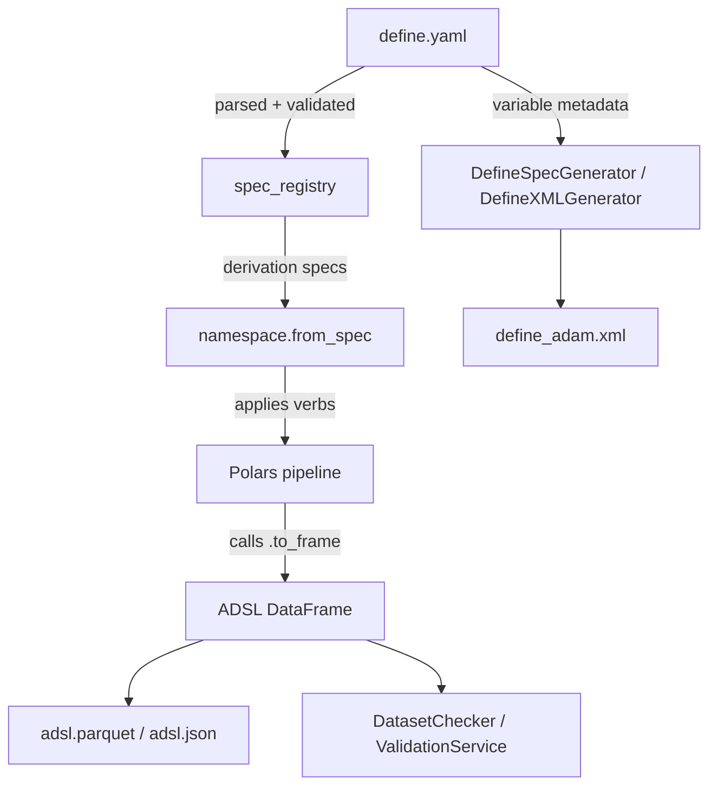

<!--
Runnable examples on this page are executed by tests/unit/test_docs_examples.py.
A fenced python or yaml block is run unless the line immediately before its
opening fence is the HTML comment "docs:no-run" (used for illustrative
fragments that reference files or study data not present in the test harness).
-->

# How `define.yaml` Drives DataFrame Creation

`define.yaml` is the **single source of truth** for a Fleet study. One file simultaneously:

1. Declares all output variables (fed to Define-XML 2.1 generation)
2. Specifies how each variable is derived (executed as a pipeline)
3. Declares codelists and controlled terminology references
4. Defines structural metadata (keys, class, structure label)

---

## File Layout

<!-- docs:no-run -->

```yaml
# yaml-language-server: $schema=../../../src/fleet/define_xml/schemas/define_spec_schema.json
fleet_spec_version: 2
study:
  id:             CDISCPILOT01
  standard:       ADAMIG
  standard_version: "1.1"

codelists:
  - oid: C66731
    name: Sex
    type: text
    items:
      - coded_value: "M"
        decode: MALE
      - coded_value: "F"
        decode: FEMALE

datasets:
  - name: ADSL
    label: Subject-Level Analysis Dataset
    structure: One record per subject
    keys: [STUDYID, USUBJID]
    inputs:
      - name: DM
        type: dataset
    variables:
      - name: STUDYID
        ...
```

The spec is validated against the bundled JSON Schema (`define_spec_schema.json`),
which is **generated from the algorithm registry** — its `algorithm:` enum and
per-algorithm required fields always match what `from_spec()` actually executes
(a CI sync test enforces this). The top-level `fleet_spec_version: 2` pins the
spec dialect; a future incompatible version is rejected with a clear message
rather than silently misinterpreted.

`fleet lsp` reads that schema straight from the installed package, so the
[Fleet VS Code extension](https://github.com/RealSlimMahdi/fleet-vscode) gives
you inline errors with no setup. Without it, a generic YAML language server can
read the same schema from a `$schema` comment — `fleet init define` prints the
exact line, resolved against your install. Adding it *alongside* the Fleet
extension reports every schema error twice, so use one or the other.

---

## Derivation Algorithms

Every spec-executable algorithm is declared once in the central registry
(`fleet.core.spec_registry`), which drives the `from_spec` executor, the
discriminated-union validation models, **and** the JSON schema.

**Two vocabularies, one mapping.** The spec dialect deliberately keeps
define-spec terminology (`assign_ct`, `hardcode_no_ct`, …) — the language a
data-standards reviewer reads in a metadata document — while the runtime API
keeps one verb per intent (`assign`). The two are not competing spellings:
every algorithm is declared **with** its runtime verb, the mapping below is
machine-checkable (`fleet.spec_coverage()`), and a CI test fails if they
drift. Splitting `assign_ct` / `assign_no_ct` in the spec is also what makes
validation strict — each algorithm gets its own required-field model, so a
CT derivation missing its codelist is a load-time error, not a runtime
surprise. A representative subset:

| `algorithm`         | Namespace verb                                                  | What it does                    |
| ------------------- | --------------------------------------------------------------- | ------------------------------- |
| `assigned`          | `.assign(target, value=...)`                                    | Constant literal for all rows   |
| `source`            | `.assign(target, source=...)`                                   | Copy column from predecessor    |
| `assign_ct`         | `.assign(target, source=..., ct=..., ct_map=...)`               | Copy + CT validate/decode       |
| `derivation`        | `.derivation(target, expression=...)`                           | Arbitrary Polars expression     |
| `first_date`        | `.first_date(target, from_dataset=..., date_col=..., where=...)`| Earliest event date per subject |
| `last_date`         | `.last_date(...)`                                               | Latest event date per subject   |
| `count_events`      | `.count_events(target, from_dataset=..., where=...)`            | Integer event count             |
| `duration`          | `.duration(target, start=..., end=...)`                        | Integer day count / elapsed time |
| `flag`              | `.flag(target, criteria=...)`                                   | `"Y"` / `null` flag             |
| `baseline` / `chg` / `pchg` | `.baseline(...)` / `.chg(...)` / `.pchg(...)`           | Baseline value & change         |
| `callable`          | `.derivation(drv_obj)`                                          | Study-specific escape hatch     |

The complete, always-current list is one call away (and `df.sdtm.verbs()` /
`df.adam.verbs()` gives the runtime-verb counterpart):

```python
import fleet

print(sorted(fleet.spec_algorithms("adam")))
print(sorted(fleet.spec_algorithms("sdtm")))
```

### The verb-coverage matrix

Not every inline verb is spec-expressible. `fleet.spec_coverage()` returns the
full algorithm ↔ verb ↔ required-fields mapping, and `fleet.SPEC_UNSUPPORTED`
is the machine-checked allowlist of verbs that have **no** spec algorithm
(e.g. `transform`, `derive_summary_records`, the TDD `add_*` verbs) — so
"which subset is spec-safe" has a definite answer instead of a guess:

```python
import fleet

matrix = fleet.spec_coverage()  # algorithm ↔ verb ↔ required fields
inline_only = fleet.SPEC_UNSUPPORTED  # {"sdtm": {...}, "adam": {...}}
print(len(matrix), "algorithms;", len(inline_only["adam"]), "adam verbs are inline-only")
```

### Study-specific callables (`callable:`)

When no built-in verb fits, point `derivation:` at a registered derivation
name or a fully qualified Python dotted path. The runtime dispatch depends
on the callable's `kind`:

- **`kind="column"`** (zero-arg, returns `pl.Expr`) — stays fully lazy,
  no DataFrame materialisation.
- **`kind="frame"` or `kind="param"`** (receives upstream DataFrame, returns
  `pl.DataFrame`) — the pipeline is materialised at that point, the function
  is called, and the result is wrapped back into the namespace.

```yaml
- name: AGEGR1
  derivation:
    algorithm: derivation
    callable: examples.cdiscpilot01.adam.derivations.AGEGR1
```

Or use the registered short name (if the derivations module was imported):

```yaml
- name: AGEGR1
  derivation:
    callable: AGEGR1 # algorithm: callable injected automatically
```

### Derivations folder convention

`fleet derivation add AGEGR1 --dataset ADSL` scaffolds a derivation file
under the study's configured programs tree:

```
programs/derivations/       # <programs dir from study_config.yaml>
    __init__.py
    AGEGR1.py
    BMI.py
```

The convention is **shared across standards** — `algorithm: callable` works
identically in SDTM and ADaM specs, because both dispatch through the same
core registry and resolver. The resolver itself does no folder scanning: a
callable is found either (a) by short name, when its module has been imported
and the function is `@derivation`-registered, or (b) by fully qualified
dotted path. Declare `derivations_module:` at the top of the spec and
`from_spec()` imports it for you, so short names always resolve.

Both `algorithm:` and `callable:` plug into Define-XML method enrichment:
running `DefineSpecGenerator(spec, enrich_methods=True)` (or
`fleet define-xml --enrich-methods`) emits one `<MethodDef>` per
**Derived** variable, named `Algorithm for <VARIABLE>`. The
`<Description>` is submission text, resolved in this order:

1. the variable's **`comment:`** — always wins;
2. for `callable:` derivations, the **study callable's docstring**
   (`@derivation` objects use their own `fn` docstring) — this is
   study-authored text; reST markup is stripped;
3. the registry's **submission-facing template** for the algorithm,
   with the spec params filled in (e.g. `chg` renders
   `Change from baseline: AVAL - BASE.`).

Fleet's *verb docstrings* are never used — they are API documentation,
identical across studies and unstable across Fleet versions. The
`<FormalExpression Context="Python/Fleet">` carries the faithful call
(the verb the algorithm runs plus the spec params, or the callable's
`dotted_path`), giving a verifiable link between the regulatory
submission and the exact code that produced the data. The verb is named
after the class that defines it, the way the run's lineage records it in
`VariableNode.method`, so an ADaM `study_day` reads
`fleet.core._verb_mixin.SharedVerbsMixin.duration('ADY', end='ASTDT', start='TRTSDT')`
in the define and in the lineage of the dataset it documents.

### Example — TRTSDT (date of first dose)

`first_date` is a real spec algorithm — this example runs end to end. In the
spec, `from_dataset:` names a **pinned dataset** (attach it with `.pin("EX", ex)`
before calling `from_spec`); the runtime resolves the name to the pinned frame.

```yaml
fleet_spec_version: 2
study:
  id: CDISCPILOT01
  standard: ADAMIG
  standard_version: "1.1"
datasets:
  - name: ADSL
    label: Subject-Level Analysis Dataset
    structure: One record per subject
    keys: [STUDYID, USUBJID]
    variables:
      - name: TRTSDT
        label: Date of First Exposure to Treatment
        type: date
        origin: Derived
        derivation:
          algorithm: first_date
          from_dataset: EX
          date_col: EXSTDTC
          where: 'pl.col("EXDOSE") > 0'
```

Run it by pinning `EX` and calling `from_spec` (the harness writes the YAML above
to `define.yaml` first):

```python
import polars as pl
import fleet  # noqa: F401

dm = pl.DataFrame({"STUDYID": ["CDISCPILOT01"] * 2, "USUBJID": ["S1", "S2"]})
ex = pl.DataFrame(
    {
        "USUBJID": ["S1", "S1", "S2"],
        "EXSTDTC": ["2014-01-05", "2014-01-02", "2014-02-01"],
        "EXDOSE": [54.0, 0.0, 54.0],  # the 0-dose row is filtered out by where=
    }
)

adsl = dm.adam.pin("EX", ex).from_spec("define.yaml", dataset="ADSL").to_frame()
print(adsl)  # TRTSDT = 2014-01-05 for S1 (earliest dosed date), 2014-02-01 for S2
```

The equivalent hand-written pipeline calls the same verb directly:

<!-- docs:no-run -->

```python
adsl = dm.adam.adsl.first_date(
    "TRTSDT", from_dataset=ex, date_col="EXSTDTC", where='pl.col("EXDOSE") > 0'
).to_frame()
```

---

## End-to-End Flow



### Running the full pipeline programmatically

`from_spec` is the execution entry point. Pin any datasets the spec references
by name, then build each dataset:

<!-- docs:no-run -->

```python
import polars as pl
import fleet  # noqa: F401

dm = pl.read_parquet("outputs/sdtm/dm.parquet")
ex = pl.read_parquet("outputs/sdtm/ex.parquet")

adsl = (
    dm.adam.pin("EX", ex)
    .from_spec("examples/cdiscpilot01/adam/define.yaml", dataset="ADSL")
    .to_frame()
)
```

`StudyContext` (via `load_study_context(config_path)`) resolves the configured
`raw_data`, `sdtm_data`, `adam_data`, and `metadata` directories so you don't
hard-code paths; it exposes `sdtm_spec` / `adam_spec` / `raw_file(...)` helpers.

### Generating Define-XML from the same spec

One CLI command — inside a study workspace, spec and output default from
`study_config.yaml`:

```bash
uv run fleet define-xml --standard adam                 # config-based defaults
uv run fleet define-xml -s specs/define.yaml -o out.xml --enrich-methods
```

The same generation from Python:

<!-- docs:no-run -->

```python
from pathlib import Path

from fleet import DefineXMLGenerator

gen = DefineXMLGenerator(Path("examples/cdiscpilot01/adam/define.yaml"))
gen.generate(Path("outputs/cdiscpilot01/define_adam.xml"))
```

`DefineSpecGenerator(spec, enrich_methods=True).generate(out)` additionally emits
a `<MethodDef>` per **Derived** variable (see *Define-XML method enrichment*
above for the text-source rule); variables with `origin: Collected`,
`Assigned`, `Protocol`, or `Predecessor` never reference a method. Generated
documents are validated on the way out — against the vendored CDISC XSDs
*and* a semantic lint (`fleet.define_xml.semantic_errors`) that rejects
reviewer-facing defects such as a `MethodOID` on a non-Derived variable or
API markup inside `TranslatedText`; `validate_xml=False` bypasses both.
Both generators honour the same new spec keys:

- **`fleet_spec_version: 2`** — spec dialect version (checked on load; 2 is the verb vocabulary of ADR-0008, `fleet migrate --spec` rewrites a version 1 file).
- **`derivations_module:`** — a dotted module that `from_spec` imports itself, so
  `callable:` derivations register without a manual import.
- **`output_format:`** — per-dataset or spec-level export format (`parquet`,
  `json`, `xpt`) recorded in the DAG and Define-XML leaf hrefs.
- **`value_level:`** — value-level metadata entries emitted as Define-XML
  `<ValueListDef>` / where-clause elements.
- **`ct: {validate: true, file: ...}`** — opt the spec into CT validation
  (see below).

---

## Codelist References

Variables can reference codelists declared in the `codelists` block:

```yaml
- name: SEX
  label: Sex
  type: text
  codelist: C66731 # references the oid in codelists[]
  derivation:
    algorithm: assign
    source: SEX
```

### Controlled terminology in the spec path

A spec step and its inline call check the same terms. Inside a study, a
`ct_codelist:` ID resolves to the class of that ID in the study's
`codelists.py`, the module `fleet init ct` generates. So this entry:

<!-- docs:no-run -->

```yaml
- name: AESEV
  codelist: C66769
  derivation:
    algorithm: assign
    source: ae_severity
```

runs as `.assign("AESEV", source="ae_severity", ct=AESEV)` with the `AESEV`
class of `codelists.py`, and a raw `Mild` gives the same warning in both
notations:
`AE.AESEV: column 'ae_severity' contains values not in codelist 'C66769': ['Mild']`.

- The study is the first `study_config.yaml` above the folder of the
  `define.yaml`, never the working directory.
- When the CT loaded in `fleet.get_validator()` holds the codelist (for
  example through `ct: file:`, below), it checks the values in both
  notations. A literal (`hardcode_ct`) is checked against the loaded CT only.
- Outside a study, before `fleet init ct`, or for an ID without a class,
  only the loaded CT can check the values.

Because both notations then trust `codelists.py`, Fleet checks the file
against the study:

| Check | Problem | Fix |
| --- | --- | --- |
| Package | The `__ct_package__` marker of the file (for older files, the package in each class's `_cdisc_url`) is not `ct.package` in `study_config.yaml`. | `fleet init ct --force` |
| Mixed packages | The classes name different CT packages. | `fleet init ct --force` |
| Missing codelist | A `codelist:` or `ct_codelist:` ID of a `define.yaml` has no class in the file. | `fleet add-ct --domains AE` (SDTM), `fleet init ct --force` (ADaM) |
| Missing file | The `define.yaml` files reference codelists, but the file does not exist. | `fleet init ct` |

`from_spec` warns once per process about all but the missing codelist, and
still checks the values against the file. An inline `ct=` class from another
package gives the package warning too. `fleet check` fails on all four, and
`fleet doctor` prints one `codelists.py` line.

### Opting the spec into CT validation

Without a `ct:` block, an `assign_ct` without `ct_mapping` checks its values
(pass-through), and one with `ct_mapping` maps them without a check. Add a
top-level `ct:` block to check every `assign_ct` / `hardcode_ct` derivation
of the spec, mapped ones included; out-of-codelist values emit a warning
naming the dataset, variable, and codelist:

<!-- docs:no-run -->

```yaml
ct:
  validate: true
  file: ct/cdisc_ct.yaml   # optional — loaded into the CT cache before the run
datasets:
  - name: DM
    variables:
      - name: SEX
        codelist: C66731
        derivation:
          algorithm: assign
          source: sex
```

When datasets are checked with `DatasetChecker(spec, check_ct=True)`, the values
are also verified against the spec's own inline `codelists:`, and codelist
lookups are normalised to concept IDs — so a spec cannot ship values that
contradict the conformance it asserts in the generated Define-XML.

---

## Schema Validation — What, When, and How

Fleet has two independent layers of schema validation for `define.yaml`. They run at different
points and catch different classes of error.

### Layer 1 — Registry model validation (pipeline-build time)

When you call `.from_spec()`, Fleet resolves each variable's `algorithm:` through
the spec registry and validates its `derivation` block against a **discriminated-union
Pydantic model** generated for that algorithm. The model declares exactly which
fields are required and sets `extra="forbid"`, so a misspelled field is a loud
error — not a silent column of nulls. This runs **immediately when `.from_spec()`
is called**, before any data is materialised.

What it catches:

- Unknown algorithm names (with a did-you-mean suggestion)
- Misspelled or unexpected fields (`extra="forbid"`)
- Missing required fields for a given `algorithm`
- Wrong field types (e.g. a list where a string is expected)

Errors are wrapped in a `SpecError` that names **file → dataset → variable**.
Here is the real message for a typo'd field (`ct_codelst` instead of
`ct_codelist`):

<!-- docs:no-run -->

```python
# derivation block with a typo:
#   - name: SEX
#     derivation:
#       algorithm: assign_ct
#       source: sex
#       ct_codelst: C66731        # ← typo: should be ct_codelist

dm = raw_df.sdtm.from_spec("specs/define.yaml", dataset="DM")
# fleet.core.exceptions.SpecError:
# specs/define.yaml → dataset DM → variable SEX: 1 validation error for SDTMAssignCtSpec
# ct_codelst
#   Extra inputs are not permitted [type=extra_forbidden, input_value='C66731', input_type=str]
```

(Note: a well-formed `assign_ct` *without* any codelist does **not** error — it
copies the value through and emits a `UserWarning` that CT could not be validated.
`assign` never fabricates a missing-field error for an optional field.)

### Layer 2 — JSON Schema + business rule validation (`DefineValidator`)

`DefineValidator` runs a deeper structural check against the bundled JSON Schema
(`src/fleet/define_xml/schemas/define_xml_2_1_schema.json`) and a set of CDISC business rules.
This layer fires **on demand**, not automatically during pipeline execution.

From the CLI, this layer is part of the one-shot CI gate — it validates every
define.yaml the study config points at:

```bash
uv run fleet check
```

Or trigger it explicitly from Python — before generating Define-XML or before
submission:

<!-- docs:no-run -->

```python
from fleet.define_xml import DefineValidator
from pathlib import Path

validator = DefineValidator()
is_valid = validator.validate(Path("examples/cdiscpilot01/sdtm/define.yaml"))

for issue in validator.issues:
    print(f"[{issue.severity.upper()}] {issue.rule} @ {issue.location}: {issue.message}")

# Example output:
# [ERROR]   SCHEMA_001 @ datasets.0.variables.2: 'type' is a required property
# [ERROR]   BR03 @ datasets.0.variables.5.codelist: CodeListRef 'C99999' not found in codelists[]
# [WARNING] ALG02 @ datasets.0.variables.3: assign_ct should have ct_codelist declared
```

What it catches:

| Rule         | Checks                                                               |
| ------------ | -------------------------------------------------------------------- |
| `SCHEMA_001` | All fields conform to the JSON Schema (types, required properties)   |
| `BR01`       | Every dataset has at least one key variable                          |
| `BR02`       | All `ItemRef` references resolve to declared variables               |
| `BR03`       | All `codelist:` references resolve to codelists declared in the spec |
| `BR04`       | All `MethodDef` references resolve                                   |
| `ALG01`      | `assign_no_ct` has `source_variable`                                 |
| `ALG02`      | `assign_ct` has both `source_variable` and `ct_codelist`             |
| `ALG03`      | `hardcode_*` has `constant_value`                                    |
| `ALG05`      | `merge` has `merge_dataset` and `merge_key`                          |

`validator.issues` is a list of `DefineIssue` dataclasses with fields `severity`, `location`,
`message`, and `rule`. `validator.has_errors()` returns `True` when any `"error"` severity
issues exist. Warnings do not block Define-XML generation.

### When to run each layer

| Layer              | When it fires                             | Blocks execution?                                               |
| ------------------ | ----------------------------------------- | --------------------------------------------------------------- |
| Registry models    | Automatically on `.from_spec()` call      | Yes — raises `SpecError` (file → dataset → variable)            |
| `DefineValidator`  | Manually, before Define-XML generation    | Only `has_errors()` returns `True`; you decide how to handle it |
| CDISC Rules Engine | Manually, after datasets are materialised | No — report only                                                |

### JSON Schema & Editor Support

The YAML spec is validated against the bundled schema at:

```
src/fleet/define_xml/schemas/define_spec_schema.json
```

This schema is **generated from the algorithm registry** — its `algorithm:`
enum, per-algorithm required fields, and the `fleet_spec_version` /
`derivations_module` properties are derived from the same declarations that
drive execution, and a CI test fails if the checked-in schema drifts. So the
editor red-squiggles you see match exactly what `from_spec()` will accept —
including the `callable` escape hatch and every algorithm the engine can run.
Regenerate it after registry changes with:

```bash
uv run python -m fleet.define_xml.schema_builder
```

Add this comment to the top of every spec file to activate YAML language-server auto-complete in
VS Code or any LSP-enabled editor:

<!-- docs:no-run -->

```yaml
# yaml-language-server: $schema=../../../src/fleet/define_xml/schemas/define_spec_schema.json
```

---

## CRF Page References

Variables with `origin: Collected` can include page references to the annotated
Case Report Form PDF. Fleet emits these as `<def:DocumentRef>` /
`<def:PDFPageRef>` elements inside `<def:Origin>` in the Define-XML, and
the standard `define2-1.xsl` stylesheet renders them as clickable links.

!!! note "One origin vocabulary"

    `origin:` uses the Define-XML 2.1 Origin Types — `Collected`,
    `Derived`, `Assigned`, `Protocol`, `Predecessor` — and the same
    values flow into `QORIG` in generated SUPPQUAL datasets. Collected
    values also carry `def:Source`, which defaults to `Investigator`
    (CRF data); override it with `origin_source: Vendor | Sponsor |
    Subject`. The Define-XML 2.0 spellings `CRF` and `eDT` are not valid.

How the Origin **description** renders, per origin type:

- **`Predecessor`** requires `predecessor: DATASET.VARIABLE` (schema-enforced);
  the define renders `Predecessor: DM.COUNTRY`. In an ADaM spec, a variable
  carried with `algorithm: source` but still marked `Collected` triggers a
  generation-time warning suggesting the Predecessor form. When freezing an
  inline pipeline, `to_spec_yaml(dataset="ADSL", predecessor="DM")` pre-fills
  these entries for carry-through columns and pure `source` copies — the
  emitted YAML stays the explicit, reviewable source of truth.
- **`Derived`** describes the derivation in its `MethodDef` (or in the Origin
  description via `comment:` when method enrichment is off).
- **`Assigned` / `Protocol`** show the `comment:` — e.g.
  `comment: DM.ARM` renders `Assigned: DM.ARM`.
- **`Collected`** with CRF pages renders the page links; Investigator-collected
  variables without pages fall back to a `Case Report Form` description.
- A variable with value-level metadata and no `comment:` renders
  `See Value Level Metadata`.

```yaml
- name: COUNTRY
  label: Country
  type: text
  origin: Predecessor
  predecessor: DM.COUNTRY
```

### Setup: declare the aCRF document

Scaffold the block with one command (config-context: it edits the study's
own define.yaml; `--standard adam|both` covers the ADaM spec too):

```bash
uv run fleet add-acrf --href blankcrf.pdf
uv run fleet add-acrf --href blankcrf.pdf --page-map acrf_pages.yaml --standard both
```

Which adds a `documents` block to the `study:` section:

```yaml
study:
  id: CDISCPILOT01
  standard: SDTMIG
  standard_version: "3.4"
  documents:
    annotated_crf:
      href: blankcrf.pdf # path in the submission package
      title: Annotated Case Report Form # displayed in Define-XML
```

This emits the top-level `<def:AnnotatedCRF>` container and the
`<def:leaf>` element that the XSLT needs to render document links.

### Layer 1 — Simple page strings (most common)

Add `crf_pages` to any collected variable:

```yaml
variables:
  - name: SEX
    label: Sex
    type: text
    origin: Collected
    crf_pages: "8" # single page
    derivation:
      algorithm: assign
      source: sex
      ct: C66731

  - name: RACE
    label: Race
    type: text
    origin: Collected
    crf_pages: "8 9" # space-separated multiple pages
```

The string value maps directly to the `PageRefs` attribute with
`Type="PhysicalRef"`.

### Layer 2 — Rich references (named destinations, page ranges)

For PDF bookmarks or page ranges, use the dict form:

```yaml
- name: SEX
  origin: Collected
  crf_pages:
    pages: "DM_SEX" # PDF bookmark name
    type: NamedDestination # or PhysicalRef (default)

- name: RACE
  origin: Collected
  crf_pages:
    pages: "8 9"
    type: PhysicalRef
    first_page: "8" # optional range attributes
    last_page: "9"
```

### Layer 3 — External page map (EDC-driven workflows)

For studies where CRF annotations are extracted from an EDC system, point
to an external YAML file:

```yaml
study:
  documents:
    annotated_crf:
      href: blankcrf.pdf
      page_map: acrf_pages.yaml # relative to the define.yaml directory
```

The page map file uses `DOMAIN.VARIABLE` keys:

```yaml
# acrf_pages.yaml — auto-generated from EDC export
DM.SEX: "7"
DM.BRTHDTC: "8"
AE.AETERM: "12 13"
VS.VSTESTCD: "20"
```

Inline `crf_pages` on individual variables always take precedence over the
external page map.

### Supplemental documents

Additional supporting documents (reviewer's guide, protocol, etc.) can be
declared alongside the annotated CRF:

```yaml
study:
  documents:
    annotated_crf:
      href: blankcrf.pdf
    supplemental_docs:
      - id: LF.ReviewerGuide
        href: reviewers-guide.pdf
        title: Reviewer's Guide
```

These emit `<def:SupplementalDoc>` and corresponding `<def:leaf>` elements.

---

## Tips

- The `inputs` block declares which upstream datasets the pipeline should join/merge.
- Variables with no `derivation` block are expected to flow in via the `source` dataset — they appear in Define-XML as `origin: Collected`.
- Run `DefineValidator("...").validate(Path("specs/.../define.yaml"))` to catch schema and business rule errors before generating Define-XML or running pipelines.
