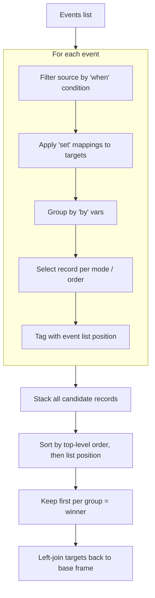

# Multi-Source Event Derivation with `pick()`

Many ADaM variables scan several data sources and keep one value per subject: the latest date over all sources, or the first source that has a value.  Admiral calls this pattern `derive_vars_extreme_event` / `event()`.  Fleet provides `pick()`, one verb that replaces multi-step joins, coalesces, and manual priority logic.

## The Problem

Consider **LSTALVDT** (Last Date Known Alive).  The derivation spec typically reads:

> Set LSTALVDT to the latest date from:
>
> 1. Death date (DTHDT) — if the subject died
> 2. Last AE end date (AEENDTC)
> 3. Last AE start date (AESTDTC)
> 4. Treatment end date (TRTEDT) — fallback

Each "event" has its own source dataset, filter condition, and column to extract.  The latest date over all events wins for each subject, whatever the list position.

Without `pick()`, you'd need:

```python
# Manual approach — 3 last_date lookups + a row-wise maximum
adsl = (
    adsl.adam.adsl.last_date("_dth", from_dataset=adsl_df, date_col="DTHDT")
    .last_date("_ae_end", from_dataset=ae, date_col="AEENDTC")
    .last_date("_ae_start", from_dataset=ae, date_col="AESTDTC")
    .derivation(
        "LSTALVDT", expression='pl.max_horizontal("_dth", "_ae_end", "_ae_start", "TRTEDT")'
    )
    .to_frame()
    .drop(["_dth", "_ae_end", "_ae_start"])
)
```

This is verbose, error-prone, and loses traceability: the record behind each date is gone.

## The Solution: `pick()`

```python
adsl = adsl.adam.adsl.pick(
    "LSTALVDT",
    events=[
        {
            "when": pl.col("DTHDT").is_not_null(),
            "set": {"LSTALVDT": "DTHDT"},
            "source": adsl_df,
            "label": "Death date",
        },
        {
            "when": pl.col("AEENDTC").is_not_null(),
            "set": {"LSTALVDT": "AEENDTC"},
            "source": ae,
            "label": "AE end date",
        },
        {
            "when": pl.col("AESTDTC").is_not_null(),
            "set": {"LSTALVDT": "AESTDTC"},
            "source": ae,
            "label": "AE start date",
        },
        {
            "when": pl.col("TRTEDT").is_not_null(),
            "set": {"LSTALVDT": "TRTEDT"},
            "label": "Treatment end (self)",
        },
    ],
    by=["USUBJID"],
    order=["LSTALVDT"],
    mode="last",
).to_frame()
```

`order=["LSTALVDT"], mode="last"` at top level makes every event compete on the date: the latest one wins.  Each event's `"label"` documents intent.  No temporary columns needed.

## How It Works



**Key properties:**

1. **Within-event selection** uses the event's `mode` and `order`, or the top-level ones.
2. **With a top-level `order`**, every event's record competes on that order and `mode`, as admiral `derive_vars_extreme_event` does.  `order=["LSTALVDT"], mode="last"` gives the latest date over all sources.  A tie goes to the first listed event.
3. **With no top-level `order`**, the first listed event that has a record wins: a priority cascade, as the admiral DTHCAUS template.
4. **Subjects with no matching events** get `null` for all targets.

## Event Dict Reference

Each event is a Python `dict` with these keys:

| Key | Required | Type | Description |
|-----|----------|------|-------------|
| `"when"` | Yes | `str \| pl.Expr` | Boolean filter — which records qualify |
| `"set"` | Yes | `dict[str, str \| pl.Expr \| Any]` | Maps each target to a source column name, expression, or literal |
| `"source"` | No | `pl.DataFrame` | External dataset to scan. Omit to use the current pipeline frame |
| `"mode"` | No | `str` | Override top-level mode for this event (`"first"` / `"last"`) |
| `"order"` | No | `str \| list[str]` | Override top-level sort for this event |
| `"label"` | No | `str` | Documentation-only description (ignored at runtime) |

## Multiple Targets

`pick()` can derive several columns simultaneously from the same events:

```python
adsl = adsl.adam.adsl.pick(
    ["LSTALVDT", "DTHFL"],
    events=[
        {
            "when": pl.col("DTHDT").is_not_null(),
            "set": {"LSTALVDT": "DTHDT", "DTHFL": pl.lit("Y")},
            "source": adsl_df,
        },
        {
            "when": pl.col("AEENDTC").is_not_null(),
            "set": {"LSTALVDT": "AEENDTC", "DTHFL": pl.lit("N")},
            "source": ae,
        },
    ],
    by=["USUBJID"],
    order=["LSTALVDT"],
    mode="last",
).to_frame()
```

When an event only sets some targets, the others remain `null` for that event's candidates.

## String Conditions (YAML-Compatible)

For spec-driven pipelines, conditions can be strings that get evaluated safely:

```python
events = [
    {"when": 'pl.col("DTHDT").is_not_null()', "set": {"LSTALVDT": "DTHDT"}},
]
```

This gives the same result as a `pl.Expr`, and a define.yaml can hold it. When an event holds a `pl.DataFrame` or a `pl.Expr`, `to_spec_yaml()` cannot write it and writes a TODO stub for the variable.

## Admiral Comparison

| Admiral | Fleet |
|---------|-------|
| `event(dataset, condition, set_values_to, order, mode)` | Event dict in `events` list |
| `derive_vars_extreme_event(events, source_datasets, by_vars, order, mode, check_type)` | `.pick(targets, events=..., by=..., order=..., mode=...)` |
| `order = exprs(LSTALVDT), mode = "last"`: latest value over all events | `order=["LSTALVDT"], mode="last"` |
| Ties on `order` go to the first event in the list | Ties on `order` go to the first event in `events` |
| DTHCAUS template: first listed event with a record | No top-level `order`: first listed event with a record |
| Requires pre-built event objects + explicit dataset references | Inline dicts with optional `"source"` — current frame used by default |

Compared with admiral, Fleet's `pick()`:

- Eliminates the need for a separate `event()` constructor
- Supports per-event mode/order overrides
- Accepts literals (`pl.lit("Y")`) directly in `"set"` alongside column references
- Chains naturally into the ADaM pipeline without materialisation breaks

## When to Use `pick()` vs `@derivation`

| Scenario | Use |
|----------|-----|
| Multi-source extreme value or first-source cascade (LSTALVDT, DTHCAUS, LDDTHELD) | `pick()` |
| Simple conditional (AGEGR1, EOSSTT) | `case_when()` |
| Complex cross-record logic within one source (CBOR confirmation rules) | `@derivation(kind="frame")` |
| Aggregation that needs custom grouping (derived parameters) | `derive_param()` |

**Rule of thumb:** If your logic is "the latest (or first) value over sources A, B and C", or "try source A, then B, then C", use `pick()`.  If it requires comparing multiple records within the same subject to determine a single result (e.g., sustained response confirmation), use a `@derivation`.

## Spec-Driven Usage

In a `define.yaml`, the pick block goes under the variable's `derivation:`. Use date columns (AEENDT, not the text AEENDTC), so that the dates compare as dates:

```yaml
variables:
  - name: LSTALVDT
    label: Last Date Known Alive
    type: date
    derivation:
      algorithm: pick
      events:
        - when: 'pl.col("DTHDT").is_not_null()'
          set: {LSTALVDT: DTHDT}
          source: ADSL
        - when: 'pl.col("AEENDT").is_not_null()'
          set: {LSTALVDT: AEENDT}
          source: AE
        - when: 'pl.col("TRTEDT").is_not_null()'
          set: {LSTALVDT: TRTEDT}
          source: ADSL
      by: [USUBJID]
      order: [LSTALVDT]
      mode: last
```

Each `source:` name is a pinned dataset. Pin them before `from_spec()`; a name with no pin raises `PinError`:

```python
adsl = (
    adsl_df.adam.adsl.pin(ADSL=adsl_df, AE=adae).from_spec("define.yaml", dataset="ADSL").to_frame()
)
```

`algorithm:`, `events:` or `targets:` beside `name:` (not under `derivation:`) raise `SpecError`.
