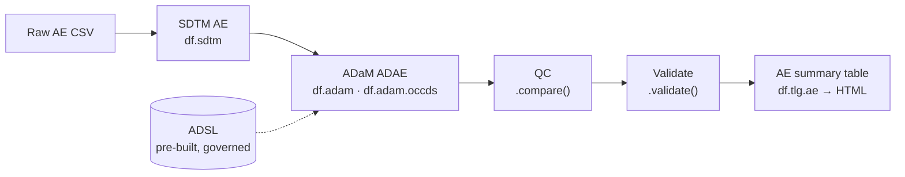
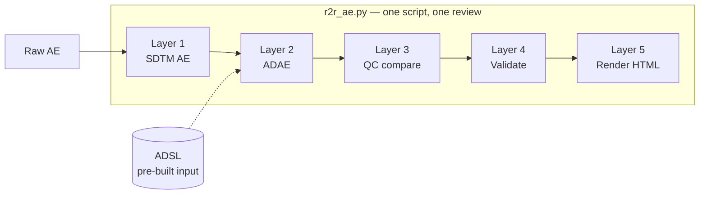

# Raw-to-Render (R2R) Strategy

## One file. One domain. Raw to Render.

The **Raw-to-Render** (R2R) strategy collapses the traditional multi-program pharma
workflow into a single, self-contained script that takes raw source data all the
way to a rendered clinical table:



DM and ADSL are assumed to already exist — they are **governed, shared artefacts**
produced by separate programs. The R2R script focuses on **one domain end-to-end**:
raw AE data through SDTM, ADaM, QC, validation, and table rendering.

Instead of maintaining separate programs for each layer — with hand-offs, naming
conventions to remember, and scattered data lineage — an R2R script keeps the
**complete derivation chain for a single domain visible in one place**.

---

## Why R2R?

### The traditional model

In conventional clinical programming, the AE deliverable involves at least
**four separate programs**, often written by different people. The last column
is the R2R layer that replaces each:

| Program       | Input          | Output               | Owner      | R2R layer           |
| ------------- | -------------- | -------------------- | ---------- | ------------------- |
| `ae.sas`      | Raw AE extract | SDTM AE              | SDTM prog. | 1 — `df.sdtm`       |
| `adae.sas`    | SDTM AE + ADSL | ADaM ADAE            | ADaM prog. | 2 — `df.adam.occds` |
| `adae_qc.sas` | SDTM AE + ADSL | PROC COMPARE listing | QC prog.   | 3 — `.compare()`    |
| `t_ae.sas`    | ADAE + ADSL    | AE summary table     | TLG prog.  | 5 — `df.tlg.ae`     |

Each program runs independently. Context about _why_ a particular derivation
exists often lives only in the developer's head or in a Word document. When the
table looks wrong, you debug backwards across four files, hoping the variable
names haven't drifted.

### The R2R model



One script. One review. When cell `(3, 2)` in the table looks wrong, scroll up —
the derivation that produced it is in the same file.

DM and ADSL remain separate, governed programs — they are shared by many domains.
The R2R script consumes ADSL as a pre-built input and owns everything else.

### Advantages

- **Full lineage visibility** — every transformation from raw value to table cell
  is traceable in a single scroll.
- **Faster debugging** — no need to run four programs and cross-reference
  intermediate datasets; breakpoints anywhere in the chain.
- **Atomic reviews** — a reviewer sees the complete picture; intent and
  implementation live together.
- **Agent-native** — an AI coding agent can reason about the entire pipeline
  in one context window, generate it end-to-end, and fix issues without
  switching files.
- **Reproducible** — one command (`uv run python r2r_ae.py`) regenerates
  everything from source.

### When to use R2R

R2R shines when:

- You need to **prototype fast** — get a table on screen from raw data in minutes.
- The domain is **self-contained** — AE, VS, LB, CM — where the analysis dataset
  depends only on its own SDTM domain plus ADSL.
- You're working with an **AI agent** that benefits from seeing the full pipeline
  in one prompt.
- You want a **living specification** — the code _is_ the documentation of how
  raw data becomes a regulatory table.

### When NOT to use R2R

- **Shared derivations** — ADSL is consumed by many domains; it deserves its own
  program with governed outputs. The R2R script **loads** ADSL as an input — it
  does not derive it.
- **Large teams** — when SDTM and ADaM are programmed by different people on
  different timelines, separation makes sense.
- **Validated production** — regulatory submissions may require individual
  program-level sign-off; R2R is ideal for exploratory and rapid development
  before refactoring into governed programs.

---

## The Layers

An R2R script is organised into clearly labelled layers. Each layer uses a
different Fleet namespace:

### Layer 0 — Inputs

Load the pre-built ADSL and the raw AE extract:

```python
import polars as pl
import fleet  # registers .sdtm / .adam / .tlg namespaces

# ADSL is produced by a separate governed program; it holds the arm as TRT01A
adsl = pl.read_csv("outputs/cdiscpilot01/adsl_admiral.csv", try_parse_dates=True)

# Raw AE — the only raw data this script owns (your study's file)
ae_raw = pl.read_csv("data/raw/ae_raw.csv")
```

### Layer 1 — SDTM (`.sdtm` namespace)

Standardise raw columns into CDISC-compliant SDTM variables:

```python
ae = (
    ae_raw.sdtm.assign("STUDYID", value="CDISCPILOT01")
    .assign("DOMAIN", value="AE")
    .assign("USUBJID", source="patient_number")
    .assign("AETERM", source="ae_term")
    .assign("AESTDTC", source="ae_start_date")
    .assign("AEENDTC", source="ae_end_date")
    .assign("AESEV", source="ae_severity")
    .assign("AESER", source="ae_serious")
    .to_frame()
)
```

### Layer 2 — ADaM ADAE (`.adam` / `.adam.occds` namespaces)

Merge ADSL treatment dates into SDTM AE, then derive analysis dates,
treatment-emergent flags, and worst-severity flags:

```python
# Merge ADSL treatment dates & population flags into SDTM AE
_adsl_trt = adsl.select(["USUBJID", "TRTSDT", "TRTEDT", "TRT01A", "SAFFL"])
ae_with_trt = ae.join(_adsl_trt, on="USUBJID", how="left")

adae = (
    ae_with_trt.adam.source("STUDYID")
    .source("USUBJID")
    .source("AETERM")
    .assign("TRTA", source="TRT01A")  # parallel design: TRTA is the ADSL actual arm
    .source("SAFFL")
    .date("ASTDT", source="AESTDTC")
    .study_day("ADY", date_col="ASTDT", ref_col="TRTSDT")
    .to_frame()
    .adam.occds.treatment_emergent(
        "TRTEMFL",
        start_date="ASTDT",
        end_date="AEENDTC",
        trtsdt="TRTSDT",
        trtedt="TRTEDT",
        end_window=0,  # the SAP decides the window after the last dose
    )
    .recode("AESEVN", source="AESEV", recode_map={"MILD": 1, "MODERATE": 2, "SEVERE": 3})
    .flag(
        "ANL01FL",
        criteria="max",
        value_col="AESEVN",
        by=["USUBJID", "AETERM"],
    )
    .seq("ASEQ", by=["USUBJID"])
    .to_frame()
)
```

### Layer 3 — QC (`.compare()`)

This is `adae_qc.sas`. A second programmer re-derives the analysis variables
from the same SDTM AE and ADSL inputs — in plain Polars expressions rather
than the first-class verbs the production chain used — and ends the chain in
[`.compare()`](../concepts/comparison.md), Fleet's PROC COMPARE. The chain is
the candidate, the production ADAE is the base, and `on_fail="raise"` turns a
difference into a stopped script:

```python
adae_qc = (
    ae_with_trt.adam.occds("ADAE")
    .derivation("ASTDT", expression=pl.col("AESTDTC").str.to_date(strict=False))
    .derivation(
        "TRTEMFL",
        expression=pl.when(
            pl.col("AESTDTC")
            .str.to_date(strict=False)
            .is_between(
                pl.col("TRTSDT").str.to_date(strict=False),
                pl.col("TRTEDT").str.to_date(strict=False),
            )
        ).then(pl.lit("Y")),
    )
    # ... AENDT, ADY, ANL01FL, ASEQ, AEDECOD and AEBODSYS likewise
    .compare(
        adae,
        keys=["USUBJID", "AESEQ"],
        variables=["ASTDT", "AENDT", "ADY", "TRTEMFL", "ANL01FL", "ASEQ", "AEDECOD", "AEBODSYS"],
        base_name="ADAE (production)",
        candidate_name="ADAE (QC)",
        on_fail="raise",
    )
    .to_frame()
)
```

`variables=` states the QC scope, so production's imputation-flag by-products
are neither compared nor reported as missing. The report is printed and kept on
the namespace as `last_comparison`:

```
Comparison report: ADAE (production) vs ADAE (QC)
======================================================================

Data set summary
----------------------------------------------------------------------
  Base:      ADAE (production)  (5 observations, 37 variables)
  Candidate: ADAE (QC)  (5 observations, 34 variables)
  Keys:      USUBJID, AESEQ
  Variables: ASTDT, AENDT, ADY, TRTEMFL, ANL01FL, ASEQ, AEDECOD, AEBODSYS  (restricted)
  Settings:  exact

Verdict
----------------------------------------------------------------------
  EQUAL: no differences found.
```

### Layer 4 — Validate

Call `.validate()` directly in the pipeline chain — it prints the conformance
report and returns the namespace unchanged so derivations can continue:

```python
ae = (
    ae_raw.sdtm.assign("STUDYID", value="CDISCPILOT01")
    .assign("DOMAIN", value="AE")
    .assign("USUBJID", source="patient_number")
    .assign("AETERM", source="ae_term")
    .assign("AESTDTC", source="ae_start_date")
    .assign("AEENDTC", source="ae_end_date")
    .assign("AESEV", source="ae_severity")
    .assign("AESER", source="ae_serious")
    .validate("AE")  # ← prints report, chain continues
    .to_frame()
)

adae = (
    ae_with_trt.adam.source("STUDYID")
    .source("USUBJID")
    .source("AETERM")
    .assign("TRTA", source="TRT01A")
    .source("SAFFL")
    .date("ASTDT", source="AESTDTC")
    .study_day("ADY", date_col="ASTDT", ref_col="TRTSDT")
    .to_frame()
    .adam.occds.treatment_emergent(
        "TRTEMFL",
        start_date="ASTDT",
        end_date="AEENDTC",
        trtsdt="TRTSDT",
        trtedt="TRTEDT",
        end_window=0,
    )
    .recode("AESEVN", source="AESEV", recode_map={"MILD": 1, "MODERATE": 2, "SEVERE": 3})
    .flag(
        "ANL01FL",
        criteria="max",
        value_col="AESEVN",
        by=["USUBJID", "AETERM"],
    )
    .seq("ASEQ", by=["USUBJID"])
    .validate("ADAE")  # ← prints report, chain continues
    .to_frame()
)
```

The report printed to stdout makes conformance issues immediately visible.
`examples/r2r_ae_example.py` gives this report (CORE engine 0.15.0). The
example sends a copy of AE with a planted AESER `"YES"` to the SDTM check
only, so CORE-000087 reports it; ADAE and the table use the clean AE.

```
======================================================================
CDISC Validation Report: AE
======================================================================
Dataset Type: sdtmig v3.4
Status: FAIL
Rules (engine run, official): 82 executed, 334 skipped, 14 could not run
Total Issues: 13
  Errors: 11, Warnings (accepted): 0, Info: 2
----------------------------------------------------------------------

ERRORS (11):
  [CORE-000087] (official) AESER: AESER is completed, but not equal to "N" or "Y"
  [CORE-000266] (official) AESER, AESCAN, AESCONG, AESDISAB, AESDTH, AESHOSP, AESLIFE, AESOD, AESMIE: If AESER = "N" then none of the seriousness criteria (AESCAN, AESCONG, AESDISAB, AESDTH, AESHOSP, AESLIFE, AESOD, AESMIE) could be equal to "Y".
  [CORE-000328] (official) AESTDTC: The Study Day of Start of Observation (AESTDY) is not present in the dataset when Start Date/Time of Observation (AESTDTC) is present.
  [CORE-000334] (official) AEBDSYCD, AEBODSYS, AEHLGT, AEHLGTCD, AEHLT, AEHLTCD, AELLT, AELLTCD, AEPTCD, AESOC, AESOCCD: At least one expected variable is missing from dataset
  [CORE-000355] (official) AEDECOD: At least one required variable is missing from dataset
  [CORE-000701] (official) EPOCH: EPOCH is missing for clinical subject-level observation.
  ... (CORE-000701 once per record, 5 in total)
  [CORE-000776] (official) AEENDTC: Study Day of End of Observation (AEENDY) variable is missing when End Date/Time of Observation (AEENDTC) is present.

======================================================================
  Planted AESER 'YES' reported by CORE-000087: yes

======================================================================
CDISC Validation Report: ADAE
======================================================================
Dataset Type: adamig v1.3
Status: NOT ASSESSED
Rules (engine run, official): 0 executed, 0 skipped, 0 could not run
Total Issues: 0
  Errors: 0, Warnings (accepted): 0, Info: 0
----------------------------------------------------------------------

  No rule executed, so nothing was assessed.

======================================================================
```

Every CORE finding blocks until the study config accepts it with a reason
(`validation.accepted`, ADR-0017). An accepted finding gives
`Status: FINDINGS (1)` and shows its reason.

### Layer 4b — Trace an issue back to its verb

`.validate()` cross-links each finding to the chain's own variable lineage, so
the report says not just *what* failed but *which verb produced it*. Nothing
extra to call — `.trail()` shows the same lineage on demand:

```python
ae = (
    ae_raw.sdtm.assign("STUDYID", value="CDISCPILOT01")
    .assign("DOMAIN", value="AE")
    .assign("USUBJID", source="patient_number")
    .assign("AETERM", source="ae_term")
    .trail()  # ← the lineage .validate() reads from
    .validate("AE")
    .to_frame()
)
```

The join is **name-exact**: each name in `ValidationIssue.variable` is matched
against `VariableNode.name`, so an issue only gains a `Producing verb` when the
chain derived that same column. A finding that names several variables
(`AESEQ, USUBJID, POOLID`) gets each verb with the variables it made
(`assign (AESEQ, USUBJID)`). A finding that names more than five variables
gets none. A finding on `AETERM` carries its origin — the verb
name plus the dotted path to its implementation:

```
2. [SDTM.AE.R0004] AETERM must not be empty
   Variable: AETERM
   Rows affected: 7 (1 occurrence)
   Producing verb: assign (fleet.sdtm.namespace.SDTMNamespace.assign)
```

`AEBODSYS` above stays bare: nothing in the chain derives it, so there is no
lineage node to match.

### Layer 5 — Render (`.tlg.ae` namespace)

Compute the Analysis Results Dataset and render to HTML:

```python
from fleet.tlg import (
    AESummarySpec,
    Row,
    Statistic,
    RenderMetadata,
    ard_to_table_model,
    render_html,
)

spec = AESummarySpec(
    rows=[
        Row(field="AEBODSYS", label="System Organ Class"),
        Row(field="AEDECOD", label="Preferred Term"),
    ],
    statistics=[Statistic.N_SUBJECTS, Statistic.N_PCT],
    adsl_group_col="TRT01A",  # ADAE arm is TRTA, ADSL arm is TRT01A
)

ard = adae.tlg.ae.t_summary(spec=spec, adsl=adsl)

meta = RenderMetadata(
    title="Table 14.3.1.1",
    subtitle="AE Summary by SOC and PT",
    footnotes=["Source: ADAE", "Population: Safety"],
)
html = render_html(ard_to_table_model(ard, meta))
Path("outputs/ae_r2r.html").write_text(html)
```

---

## R2R and Agentic Coding

R2R was designed for a reviewable human workflow — one file, one reading order, one
visible output. AI agents happen to need exactly the same things, which is why they
do well with it:

1. **Single-context reasoning** — The entire derivation fits in one file (and one
   prompt). An agent doesn't need to discover dependencies across a file tree.

2. **End-to-end generation** — Given a raw dataset schema and a target table shell,
   an agent can generate a complete R2R script in one pass — no multi-turn
   orchestration.

3. **Instant feedback** — The script produces a visible output (HTML table). The
   agent (or user) can inspect the result and iterate without leaving the file.

4. **Self-documenting** — The layered structure doubles as executable documentation.
   An agent reading the file can explain every derivation decision from raw to
   table.

5. **Deterministic re-execution** — One `uv run python r2r_ae.py` reproduces the
   full artefact. No DAG scheduler, no Makefile, no external state.

### Agent prompt pattern

> "Using Fleet's R2R pattern, write a single Python script that takes
> `ae_raw.csv` and a pre-built ADSL (`adsl_admiral.csv`) and produces an
> HTML AE summary table (Table 14.3.1.1). Include SDTM AE, ADAE with
> treatment-emergent flags, pre-validation, and a rendered HTML output."

The agent returns a complete, runnable script — no follow-up questions needed.

---

## Running the Example

The full working example is at [`examples/r2r_ae_example.py`](https://github.com/RealSlimMahdi/fleet-cdisc/blob/main/examples/r2r_ae_example.py):

```bash
uv run python examples/r2r_ae_example.py
```

Output:

```
━━ Layer 0 · Inputs ━━━━━━━━━━━━━━━━━━━━━━━━━━━━━━━━━━━━━━━━━━━━━━━━━━
  ADSL (pre-built) : 5 subjects × 33 variables
  ae_raw           :   5 rows × 9 cols

━━ Layer 1 · SDTM AE ━━━━━━━━━━━━━━━━━━━━━━━━━━━━━━━━━━━━━━━━━━━━━━━━
  AE : 5 records × 21 variables

━━ Layer 2 · ADaM ADAE ━━━━━━━━━━━━━━━━━━━━━━━━━━━━━━━━━━━━━━━━━━━━━━
  ADAE : 5 records × 37 variables

━━ Layer 3 · QC ━━━━━━━━━━━━━━━━━━━━━━━━━━━━━━━━━━━━━━━━━━━━━━━━━━━━━━
  EQUAL: no differences found.

━━ Layer 4 · Validate ━━━━━━━━━━━━━━━━━━━━━━━━━━━━━━━━━━━━━━━━━━━━━━━━
  ✓ TLG pre-validation passed

━━ Layer 5 · Render ━━━━━━━━━━━━━━━━━━━━━━━━━━━━━━━━━━━━━━━━━━━━━━━━━━
  ARD: 155 rows × 15 cols → ae_r2r.html

━━ R2R Complete ━━━━━━━━━━━━━━━━━━━━━━━━━━━━━━━━━━━━━━━━━━━━━━━━━━━━━━
  ADaM → QC        : 8 variables compared → EQUAL
  One file. One domain. Raw to Render.
```
