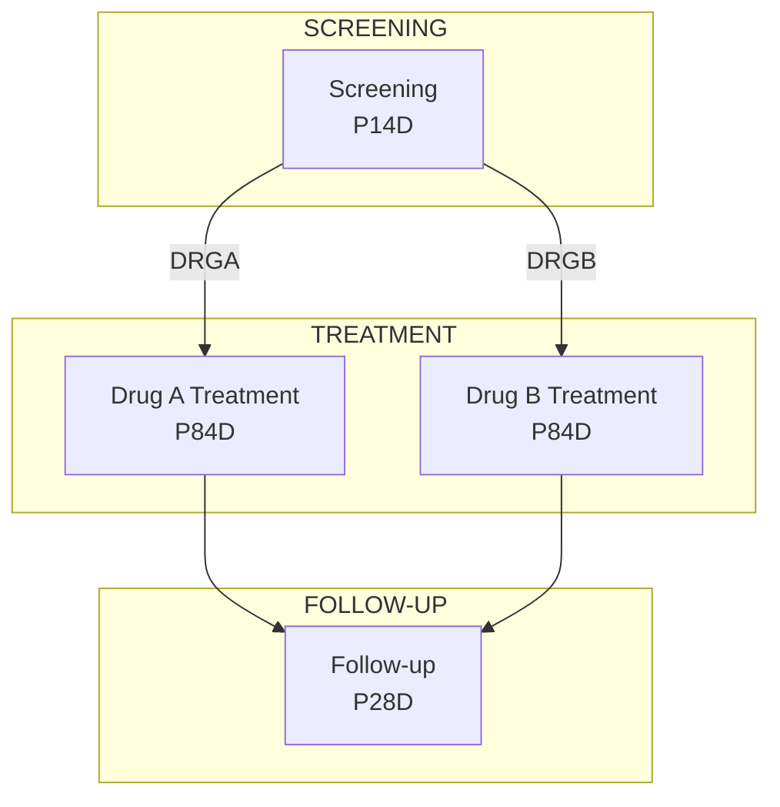

# Trial Design, Fully Offline

Trial Design is the one corner of a study you can build **before any data
exists** — and in Fleet it needs no API key either: SDTMIG 3.4 structures
for all nine TDD domains ship with the package. This walkthrough goes from
a design definition to audited, submission-shaped datasets in five steps.
The runnable script is `examples/tdd_example.py`.

## 1. Define the design once

Arms are **element paths** — `TAETORD`, `ELEMENT`, `EPOCH`, and `TABRANCH`
(at the randomization branch) are derived, never typed by hand:

```python
import fleet
from fleet.sdtm.tdd import TrialVisits

design = fleet.StudyDesign(
    study_id="MYSTUDY01",
    elements=[
        {
            "etcd": "SCRN",
            "element": "Screening",
            "tedur": "P14D",
            "epoch": "SCREENING",
            "testrl": "INFORMED CONSENT",
        },
        {
            "etcd": "TRTA",
            "element": "Drug A Treatment",
            "tedur": "P84D",
            "epoch": "TREATMENT",
            "testrl": "RANDOMIZATION",
        },
        {
            "etcd": "TRTB",
            "element": "Drug B Treatment",
            "tedur": "P84D",
            "epoch": "TREATMENT",
            "testrl": "RANDOMIZATION",
        },
        {
            "etcd": "FU",
            "element": "Follow-up",
            "tedur": "P28D",
            "epoch": "FOLLOW-UP",
            "testrl": "END OF TREATMENT + 1",
        },
    ],
    arms={"DRGA": ["SCRN", "TRTA", "FU"], "DRGB": ["SCRN", "TRTB", "FU"]},
    arm_names={"DRGA": "Drug A", "DRGB": "Drug B"},
    visits=TrialVisits.from_schedule(
        [("Screening", -14), ("Baseline", 0), ("Week 4", 28), ("Week 8", 56)],
        anchor="RANDOMIZATION",
        window=3,
    ).visits,
)
```

## 2. Derive every domain

```python
frames = design.domains()  # {"TE": df, "TA": df, "TV": df, ...}
print(frames["TA"])
```

```text
┌───────────┬────────┬───────┬────────┬─────────┬──────┬──────────────────┬─────────────────────┬─────────┬───────────┐
│ STUDYID   ┆ DOMAIN ┆ ARMCD ┆ ARM    ┆ TAETORD ┆ ETCD ┆ ELEMENT          ┆ TABRANCH            ┆ TATRANS ┆ EPOCH     │
╞═══════════╪════════╪═══════╪════════╪═════════╪══════╪══════════════════╪═════════════════════╪═════════╪═══════════╡
│ MYSTUDY01 ┆ TA     ┆ DRGA  ┆ Drug A ┆ 1       ┆ SCRN ┆ Screening        ┆ Randomized to Drug A┆         ┆ SCREENING │
│ MYSTUDY01 ┆ TA     ┆ DRGA  ┆ Drug A ┆ 2       ┆ TRTA ┆ Drug A Treatment ┆                     ┆         ┆ TREATMENT │
│ …         ┆        ┆       ┆        ┆         ┆      ┆                  ┆                     ┆         ┆           │
└───────────┴────────┴───────┴────────┴─────────┴──────┴──────────────────┴─────────────────────┴─────────┴───────────┘
```

## 3. Audit before anyone else does

`design.audit()` runs the P21-style conformance battery offline — findings
carry the public rule IDs, and a missing FDA-required TS parameter is
flagged before a validator ever sees the data:

```python
findings = design.audit()
print(findings.head(3))
```

```text
┌─────────┬──────────┬────────┬────────────────────────────────────────────────┐
│ rule_id ┆ severity ┆ domain ┆ message                                        │
╞═════════╪══════════╪════════╪════════════════════════════════════════════════╡
│ SD2213  ┆ error    ┆ TS     ┆ Required TS parameter 'TITLE' is missing       │
│ SD2214  ┆ error    ┆ TS     ┆ Required TS parameter 'TPHASE' is missing      │
│ SD2232  ┆ error    ┆ TS     ┆ Required TS parameter 'SSTDTC' is missing      │
│         ┆          ┆        ┆ (FDA rejection criterion 1734)                 │
└─────────┴──────────┴────────┴────────────────────────────────────────────────┘
```

## 4. Fill TS from ClinicalTrials.gov

The registry already knows most of the FDA-required TS parameters — seed
them straight from the study's NCT registration:

```bash
uv run fleet tdd ctgov NCT04280705 --write   # merge into trial_design.yaml
```

```text
28 parameter(s) from NCT04280705 merged into metadata/sdtm/trial_design.yaml (2 already present).
```

## 5. Build (and re-audit) from the CLI

Persist the design as YAML next to your study metadata, then let the CLI do
the rest — inside a study workspace, spec and output paths resolve from
`study_config.yaml`:

```python
design.to_yaml("metadata/sdtm/trial_design.yaml")
```

```bash
uv run fleet tdd audit                # conformance pre-check, exit 1 on errors
uv run fleet tdd build --format xpt   # audit + write te/ta/tv/ts/... to <sdtm_data>
```

## Bonus: the design is a diagram

`to_mermaid()` renders the arm/element/epoch structure for protocol review
decks. `StudyDesign.from_mermaid()` reads the arm paths, ETCD, ELEMENT, TEDUR
and the epochs back. The diagram does not carry ARM, TESTRL, TEENRL, TABRANCH,
TATRANS or a crossover, so `to_mermaid()` warns when a design cannot be read
back. YAML (`design.to_yaml()`) is the lossless round trip:

```python
print(design.to_mermaid())
```



USDM imports (`StudyDesign.from_usdm()`), the subject-level SV/SE verbs,
and the full rule table are covered in the
[Trial Design concepts page](../concepts/tdd.md).
