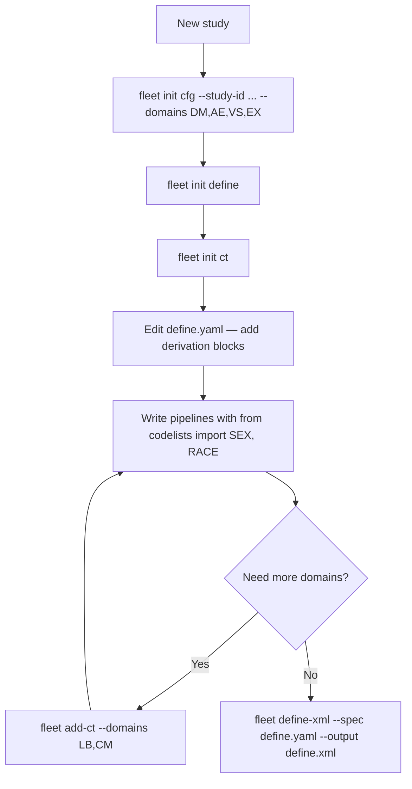

# CLI Reference

Fleet provides the `fleet` command-line tool for bootstrapping studies, generating define specs, managing CDISC Controlled Terminology, and producing Define-XML. Commands that query the CDISC Library require a valid `CDISC_API_KEY` — set it in a `.env` file at your project root or as an environment variable.

```bash title=".env"
CDISC_API_KEY=your-api-key-here
```

---

## Bootstrapping Pipeline

The recommended way to start a new study. Run these three commands in order:

```bash
fleet init cfg    --study-id STUDY01 --domains DM,AE,VS,EX --adam-datasets ADSL,ADVS
fleet init define                      # reads study_config.yaml, queries CDISC IG
fleet init ct                          # reads define.yaml, downloads codelists
```

!!! note "Using `--root`?"
If you pass `--root` to `init cfg` (e.g. `--root ./my_study`), the config is written
to `./my_study/study_config.yaml` instead of the current directory. You must then pass
`--config ./my_study/study_config.yaml` to every subsequent `init` command — or `cd`
into that directory before running them:

    ```bash
    fleet init cfg --study-id STUDY01 --domains DM,AE,VS,EX --root ./my_study
    fleet init define --config ./my_study/study_config.yaml
    fleet init ct     --config ./my_study/study_config.yaml
    ```

### `fleet init cfg`

Create `study_config.yaml` and the study directory structure.

```bash
fleet init cfg --study-id CDISCPILOT01 --company "CDISC" \
  --domains DM,AE,VS,EX --adam-datasets ADSL,ADVS,ADAE --root ./my_study
```

| Option            | Default             | Description                   |
| ----------------- | ------------------- | ----------------------------- |
| `--study-id`      | _(required)_        | Study identifier              |
| `--company`       | _(none)_            | Originator / company name     |
| `--domains`       | _(none)_            | Comma-separated SDTM domains  |
| `--adam-datasets` | _(none)_            | Comma-separated ADaM datasets |
| `--ig`            | `3-4`               | SDTM IG version               |
| `--adam-ig`       | `1-1`               | ADaM IG version               |
| `--package`       | `sdtmct-2023-12-15` | CT package version            |
| `--root` / `-r`   | `.`                 | Study root directory          |

!!! warning "Non-default `--root` requires `--config` in subsequent commands"
When `--root` is set to anything other than `.`, the generated `study_config.yaml`
lives inside that folder. The next commands (`fleet init define`, `fleet init ct`)
default to looking for `study_config.yaml` in the **current working directory**.
Pass `--config <root>/study_config.yaml` explicitly, or `cd` into the root first.

### `fleet init define`

Generate `define.yaml` files pre-populated with standard variables from the CDISC Library IG. Reads domains/datasets from `study_config.yaml`.

```bash
fleet init define                              # both SDTM + ADaM (default)
fleet init define --sdtm-only                  # SDTM only
fleet init define --adam-only                  # ADaM only
fleet init define --config path/to/config.yaml # custom config location
```

| Option            | Default             | Description                          |
| ----------------- | ------------------- | ------------------------------------ |
| `--config` / `-c` | `study_config.yaml` | Path to config file                  |
| `--sdtm-only`     | _(off)_             | Generate SDTM define only            |
| `--adam-only`     | _(off)_             | Generate ADaM define only            |
| `--force`         | _(off)_             | Overwrite existing define.yaml files |

The generated YAML includes variable names, labels, types, mandatory flags, **CDISC core designations** (`Req`, `Exp`, `Perm`, `Conditionally Required`), codelist references, and origin hints — all sourced from the CDISC Library. The `core` field enables graduated check severity (see [DatasetChecker](#datasetChecker) below). Variables are created **without** derivation blocks (carry-through columns); add derivation blocks to drive the pipeline.

### `fleet init ct`

Generate `codelists.py` from the codelist references in the `define.yaml` files. Reads all define specs and downloads the referenced codelists from the CDISC Library.

```bash
fleet init ct                                # reads config + both defines
fleet init ct --config path/to/config.yaml   # custom config location
fleet init ct --no-docs                      # lightweight file
fleet init ct --force                        # overwrite existing codelists.py
```

| Option            | Default             | Description                          |
| ----------------- | ------------------- | ------------------------------------ |
| `--config` / `-c` | `study_config.yaml` | Path to config file                  |
| `--no-docs`       | _(off)_             | Omit definitions and preferred terms |
| `--force`         | _(off)_             | Overwrite existing codelists.py      |

---

## Standalone Commands

These commands work independently of the bootstrapping pipeline.

## `fleet init-ct`

Bootstrap a `codelists.py` from the CDISC Library SDTM Implementation Guide.

This is a **one-time** operation when setting up a new study. It queries the SDTM IG to discover every codelist referenced by variables in the requested domains, then downloads the term definitions and generates a typed Python module.

```bash
fleet init-ct --domains DM,AE,VS,EX --output specs/my_study/sdtm/codelists.py
```

### Options

| Option            | Default             | Description                                                       |
| ----------------- | ------------------- | ----------------------------------------------------------------- |
| `--domains`       | _(required)_        | Comma-separated SDTM domain abbreviations (e.g. `DM,AE,VS,EX,LB`) |
| `--output` / `-o` | `codelists.py`      | Output file path                                                  |
| `--ig`            | `3-4`               | SDTM IG version                                                   |
| `--package`       | `sdtmct-2023-12-15` | CT package version to download terms from                         |
| `--no-docs`       | _(off)_             | Omit definitions and preferred terms (smaller file)               |

### Examples

```bash
# Standard bootstrap for a typical study
fleet init-ct --domains DM,AE,VS,EX --output specs/cdiscpilot01/sdtm/codelists.py

# Pin to a specific CT version
fleet init-ct --domains DM,AE --ig 3-4 --package sdtmct-2025-09-26 --output codelists.py

# Generate a lightweight file without definitions
fleet init-ct --domains DM --no-docs --output codelists.py
```

---

## `fleet add-ct`

Add domains to an **existing** `codelists.py` without losing previously generated codelists.

This command reads the existing file, detects which concept IDs are already present, discovers the new codelists required by the requested domains, and regenerates the file with the merged set.

```bash
fleet add-ct --domains LB,CM --output specs/my_study/sdtm/codelists.py
```

### Options

Same as `init-ct`. The `--output` path must point to an existing `codelists.py` (or a new file — in which case it behaves like `init-ct`).

### Examples

```bash
# Add lab and conmed domains to an existing file
fleet add-ct --domains LB,CM --output specs/cdiscpilot01/sdtm/codelists.py

# If all codelists are already present, the command reports "Nothing to add"
fleet add-ct --domains DM --output specs/cdiscpilot01/sdtm/codelists.py
```

### Typical output

```
Adding domains: LB, CM
Existing file:  specs/cdiscpilot01/sdtm/codelists.py (24 codelists)

New codelists to add: 8
Total after merge:    32

Updated /path/to/codelists.py — 32 codelists
```

---

## `fleet add-rule`

Scaffold a new custom validation rule YAML skeleton.

Generates a schema-valid CDISC rule file with all required sections pre-filled. Only the
`Check:` block needs to be edited with your validation logic.

```bash
# Minimal — auto-increments ID (FLEET-AE-001, FLEET-AE-002, …)
fleet add-rule --domain AE --description "AESEV must be populated when AESER = Y"

# Custom company prefix
fleet add-rule --domain AE --prefix ROCHE --description "Severity check"

# Explicit rule ID (skips auto-increment)
fleet add-rule --domain VS --id ROCHE-VS-010 --description "VSORRES range check"

# Write to a specific directory (overrides study_config)
fleet add-rule --domain DM --description "RFICDTC check" --output ./my_rules/
```

### Options

| Option            | Default                                            | Description                                         |
| ----------------- | -------------------------------------------------- | --------------------------------------------------- |
| `--domain`        | _(required)_                                       | SDTM/ADaM domain code (e.g. `AE`, `DM`, `VS`)       |
| `--description`   | _(required)_                                       | Human-readable rule description (used in `Outcome`) |
| `--prefix`        | `FLEET`                                            | Rule ID prefix (e.g. your company name)             |
| `--id`            | _(auto)_                                           | Explicit rule ID; skips auto-increment              |
| `--output` / `-o` | `validation.custom_rules` from `study_config.yaml` | Output directory                                    |

The auto-increment scans all existing `.yaml` files in the target directory and picks the next
available sequence number for the given prefix/domain combination. A uniqueness check prevents
overwriting an existing rule.

### Generated file header

Each scaffolded file includes a header comment with:

- A link to the CDISC Rules Engine wiki for operator reference
- A quick reference of rule types (Record, Value-level, Cross-dataset)
- The exact `fleet check-rule` command to validate the file
- The `.validate("DOMAIN", custom_rules="<dir>")` pipeline usage

---

## `fleet check-rule`

Validate a custom rule YAML file before running it against datasets.

Performs three levels of checking:

1. **YAML syntax** — can the file be parsed? Reports line/column on error.
2. **Structure** — required top-level keys, `Core.Id`, `Check` combinator, non-empty `Scope.Domains`.
3. **JSON Schema** — full validation against the vendored CDISC rule schema.

```bash
fleet check-rule metadata/custom_rules/FLEET-AE-001.yaml
```

### Example output (passing)

```
Checking rule: metadata/custom_rules/FLEET-AE-001.yaml
────────────────────────────────────────────────────────────
  Rule ID:   FLEET-AE-001
  Type:      Record Data
  Domains:   AE

  ✓ YAML syntax OK
  ✓ Structure OK
  ✓ Schema validation PASSED
```

### Example output (failing)

```
  ✗ Missing required top-level keys: Core, Rule Type, Scope
  ✗ Core.Id is missing or empty
  ✗ Schema: (root): 'Authorities' is a required property
  ✗ Schema: (root): 'Outcome' is a required property

  4 error(s) found.
```

Exits with code 1 if any errors are found — suitable for use as a CI gate.

---

## Workflow

The recommended bootstrapping workflow for a new study:



### Source of truth

The source of truth for which variables and codelists to generate is the **CDISC Library IG model**. The `init define` command queries the IG endpoints and extracts variable metadata (name, label, type, core, codelist) from each domain. The `init ct` command then reads the generated `define.yaml` to download the exact codelists referenced.

---

## `fleet add-rule`

Scaffold a schema-valid custom validation rule YAML skeleton. Auto-increments the rule ID
by scanning the target directory; the programmer only needs to fill in the `Check:` block.

```bash
# Minimal — writes FLEET-AE-001.yaml to the configured custom_rules directory
fleet add-rule --domain AE --description "AESEV must be populated when AESER = Y"

# Custom prefix
fleet add-rule --domain AE --prefix ROCHE --description "Severity check for serious AEs"

# Explicit rule ID (skips auto-increment)
fleet add-rule --domain AE --id ROCHE-AE-042 --description "Custom range check"

# Write to a specific directory
fleet add-rule --domain VS --description "VSORRES range check" --output ./my_rules/
```

| Option            | Default                                            | Description                                    |
| ----------------- | -------------------------------------------------- | ---------------------------------------------- |
| `--domain`        | _(required)_                                       | SDTM/ADaM domain code (e.g. `AE`, `DM`, `VS`)  |
| `--description`   | _(required)_                                       | Human-readable rule description                |
| `--prefix`        | `FLEET`                                            | Rule ID prefix (e.g. `ROCHE` → `ROCHE-AE-001`) |
| `--id`            | _(auto-increment)_                                 | Explicit rule ID override                      |
| `--output` / `-o` | `validation.custom_rules` from `study_config.yaml` | Output directory                               |

The generated YAML includes all required CDISC schema sections. The `Check:` block contains
a placeholder with a `# TODO` comment and a link to the CDISC Rules Engine operator reference.

---

## `fleet check-rule`

Validate a custom rule YAML on the fly — before running the engine against real data.

```bash
fleet check-rule my_rules/FLEET-AE-001.yaml
```

Performs three validation levels:

1. **YAML syntax** — reports exact line and column for parse errors
2. **Structure** — checks required top-level keys, `Core.Id`, combinators in `Check:`,
   non-empty `Scope.Domains`
3. **JSON Schema** — full validation against the vendored CDISC rule schema

Exits `0` on success, `1` on any error — scriptable in CI pipelines.

```
Checking rule: my_rules/FLEET-AE-001.yaml
────────────────────────────────────────────────────────────
  Rule ID:   FLEET-AE-001
  Type:      Record Data
  Domains:   AE

  ✓ YAML syntax OK
  ✓ Structure OK
  ✓ Schema validation PASSED
```

| Option      | Description                    |
| ----------- | ------------------------------ |
| `rule_file` | Path to the rule YAML to check |

Generate a CDISC Define-XML 2.1 document from a `define.yaml` specification.

```bash
fleet define-xml --spec specs/cdiscpilot01/sdtm/define.yaml --output outputs/define_sdtm.xml
```

### Options

| Option            | Default      | Description                                        |
| ----------------- | ------------ | -------------------------------------------------- |
| `--spec` / `-s`   | _(required)_ | Path to the `define.yaml` specification file       |
| `--output` / `-o` | _(required)_ | Output path for the Define-XML file                |
| `--no-preview`    | _(off)_      | Skip generating the HTML preview alongside the XML |

By default, an HTML preview is generated alongside the XML (e.g. `define_sdtm.xml` → `define_sdtm_preview.html`) using the CDISC `define2-1.xsl` stylesheet. Place `define2-1.xsl` in the same directory as the output XML, or the preview step will be skipped with a warning.

### Examples

```bash
# Generate SDTM Define-XML with HTML preview
fleet define-xml --spec specs/cdiscpilot01/sdtm/define.yaml --output outputs/define_sdtm.xml

# Generate ADaM Define-XML without preview
fleet define-xml --spec specs/cdiscpilot01/adam/define.yaml --output outputs/define_adam.xml --no-preview
```
