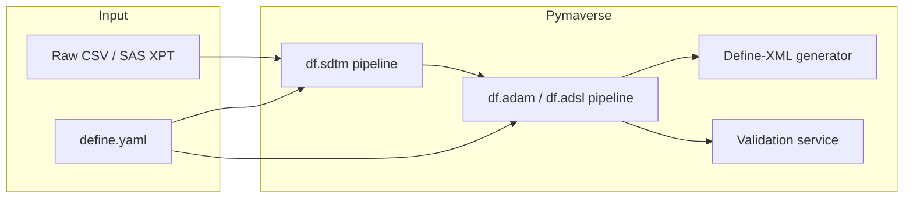

# Pymaverse

**CDISC SDTM/ADaM derivation toolkit for [Polars](https://pola.rs) DataFrames.**

[](https://github.com/pymaverse/pymaverse/actions/workflows/ci.yml)
[](https://pymaverse.github.io/pymaverse/)
[](https://pypi.org/project/pymaverse/)
[](https://www.python.org/)
[](https://opensource.org/licenses/Apache-2.0)

---

## What is Pymaverse?

Pymaverse adds **chainable verb pipelines** directly onto every Polars DataFrame so you can build standards-compliant CDISC datasets with minimal boilerplate:

```python
import pymaverse
import polars as pl

# SDTM DM domain from raw data
dm = (
    raw_df.sdtm
    .hardcode_no_ct("DOMAIN",  value="DM")
    .hardcode_no_ct("STUDYID", value="MYSTUDY01")
    .assign_no_ct("USUBJID",   source="patient_id")
    .assign_ct("SEX", source="sex_raw",
               ct_codelist="C66731", ct_mapping={"M": "M", "F": "F"})
    .to_frame()
)

# ADaM BDS dataset (ADVS) from SDTM
advs = (
    vs_sdtm.adam
    .source("USUBJID")
    .study_day("ADY", analysis_date="ADT", reference_date="TRTSDT")
    .baseline("BASE", aval="AVAL", baseline_flag="ABLFL")
    .chg("CHG", aval="AVAL", base="BASE")
    .to_frame()
)
```

Nothing runs until you call `.to_frame()`. All intermediate verbs accumulate into a single Polars `with_columns` pass — no intermediate allocations.

---

## Namespace Extensions

Importing `pymaverse` registers four chainable namespaces on **every** Polars DataFrame:

| Namespace  | Target dataset      | Description                                                            |
| ---------- | ------------------- | ---------------------------------------------------------------------- |
| `df.sdtm`  | SDTM domains        | 14 derivation verbs: domain mapping, CT lookup, datetime normalisation |
| `df.adam`  | ADaM BDS            | 16 derivation verbs: study day, baseline, change, flags                |
| `df.adsl`  | ADSL                | 6 patient-level verbs: treatment dates, duration, population flags     |
| `df.occds` | OCCDS (ADAE, ADCM…) | 5 occurrence verbs: first/last date, worst severity                    |

Therapeutic-area extensions (`df.onco`, `df.ophtha`, `df.peds`, `df.vaccine`, `df.metabolic`, `df.neuro`) mirror the [admiral TA packages](https://pharmaverse.github.io/admiral/).

---

## Architecture at a Glance



---

## Quick Links

- [Installation & Quickstart](getting-started/installation.md)
- [How define.yaml drives DataFrame creation](concepts/define-yaml.md)
- [ADSL pipeline walkthrough (notebook)](examples/adsl_pipeline.ipynb)
- [API Reference](api/index.md)
- [Test Status](test-status.md)
