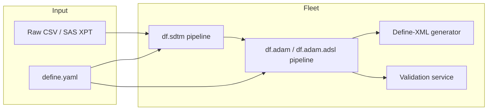

# Fleet

**CDISC SDTM/ADaM derivation toolkit for [Polars](https://pola.rs) DataFrames.**

[](https://github.com/RealSlimMahdi/fleet-cdisc/actions/workflows/ci.yml)
[](https://github.com/RealSlimMahdi/fleet-cdisc)
[](https://github.com/RealSlimMahdi/fleet-cdisc)
[](https://realslimmahdi.github.io/fleet-cdisc/)
[](https://pypi.org/project/fleet-cdisc/)
[](https://www.python.org/)
[](https://opensource.org/licenses/MIT)

---

## What is Fleet?

Fleet adds **chainable verb pipelines** directly onto every Polars DataFrame so you can build standards-compliant CDISC datasets with minimal boilerplate:

```python
import fleet
import polars as pl
from codelists import SEX  # generated by: fleet init ct

# SDTM DM domain from raw data
dm = (
    raw_df.sdtm
    .hardcode_no_ct("DOMAIN",  value="DM")
    .hardcode_no_ct("STUDYID", value="MYSTUDY01")
    .assign_no_ct("USUBJID",   source="patient_id")
    .assign_ct("SEX", source="sex_raw",
               ct_codelist=SEX, ct_mapping={"M": "M", "F": "F"})
    .to_frame()
)

# ADaM BDS dataset (ADVS) from SDTM
advs = (
    vs_sdtm.adam
    .source("USUBJID")
    .study_day("ADY", analysis_date="ADT", reference_date="TRTSDT")
    .baseline("BASE", aval="AVAL", baseline_flag="ABLFL")
    .chg("CHG", aval="AVAL", base="BASE")
    .to_frame()
)
```

Nothing runs until you call `.to_frame()`. All intermediate verbs accumulate into a single Polars `with_columns` pass — no intermediate allocations.

---

## Namespace Extensions

Importing `fleet` registers two chainable namespaces on **every** Polars DataFrame:

| Namespace | Target dataset | Description                                                                                   |
| --------- | -------------- | --------------------------------------------------------------------------------------------- |
| `df.sdtm` | SDTM domains   | 14 derivation verbs: domain mapping, CT lookup, datetime normalisation                        |
| `df.adam` | ADaM BDS       | 22 derivation verbs: study day, baseline, change, flags, BSA, MAP, QTc, LOCF, summary records |

ADaM sub-structures and therapeutic-area extensions are nested under `df.adam`:

| Property            | Target dataset      | Description                                                                                 |
| ------------------- | ------------------- | ------------------------------------------------------------------------------------------- |
| `df.adam.adsl`      | ADSL                | 8 patient-level verbs: treatment dates, duration, population flags, age conversion, periods |
| `df.adam.occds`     | OCCDS (ADAE, ADCM…) | 5 occurrence verbs: first/last date, worst severity                                         |
| `df.adam.onco`      | Oncology            | RECIST response, BOR, filter_pd                                                             |
| `df.adam.ophtha`    | Ophthalmology       | ETDRS/LogMAR, study eye                                                                     |
| `df.adam.peds`      | Pediatrics          | Age derivations, prematurity                                                                |
| `df.adam.vaccine`   | Vaccine             | Fever, seroconversion, ADIS AVAL                                                            |
| `df.adam.metabolic` | Metabolic           | Waist ratios, body fat %                                                                    |
| `df.adam.neuro`     | Neuroscience        | Centiloid, MMSE, CDR-SoB                                                                    |

These mirror the [admiral TA packages](https://pharmaverse.github.io/admiral/).

---

## Architecture at a Glance



---

## Quick Links

- **New to Fleet?** Read [Why Fleet?](why-fleet.md) to understand how we compare to manual approaches.
- [Installation](getting-started/installation.md) & [Quickstart](getting-started/quickstart.md)
- [CLI Reference](getting-started/cli.md) — bootstrapping pipeline (`fleet init cfg/define/ct`) and standalone CT commands
- [How define.yaml drives DataFrame creation](concepts/define-yaml.md)
- [ADSL pipeline walkthrough (notebook)](examples/02_spec_driven_pipeline.ipynb)
- [API Reference](api/index.md)
- [Test Status](test-status.md)
