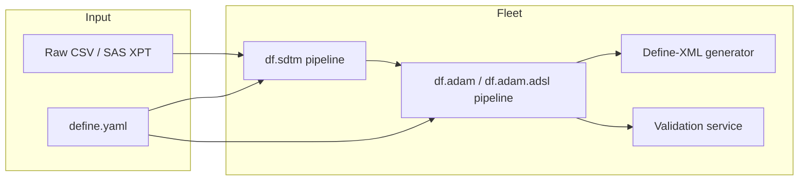

# Fleet

**Fleet** is a lazy expression accumulator with an immutable builder API that specializes in creating **CDISC SDTM/ADaM** datasets using the well-known [Polars](https://pola.rs) library.

<div class="grid cards" markdown>

- :material-speedometer: **Performance** blazing fast polars API
- :material-robot-happy-outline: Designed as an **AI-first** toolkit
- :material-package-variant-closed-minus: **Six** core dependencies, extras are opt-in
- :simple-gitextensions: **Extensible API** to match your own standards

</div>

[](https://github.com/RealSlimMahdi/fleet-cdisc/actions/workflows/ci.yml)
[](https://github.com/RealSlimMahdi/fleet-cdisc)
[](https://github.com/RealSlimMahdi/fleet-cdisc)
[](https://realslimmahdi.github.io/fleet-cdisc/)
[](https://pypi.org/project/fleet-cdisc/)
[](https://www.python.org/)
[](https://opensource.org/licenses/MIT)

---

## What is Fleet?

Fleet adds **chainable verb pipelines** directly onto every Polars DataFrame so you can build standards-compliant CDISC datasets with minimal boilerplate:

```python
import fleet
import polars as pl
from codelists import SEX  # generated by: fleet init ct

# SDTM DM domain from raw data — `assign` is the one assignment verb
dm = (
    raw_df.sdtm.assign("DOMAIN", value="DM")
    .assign("STUDYID", value="MYSTUDY01")
    .assign("USUBJID", source="patient_id")
    .assign("SEX", source="sex_raw", ct=SEX, ct_map={"M": "M", "F": "F"})
    .to_frame()
)

# ADaM BDS dataset (ADVS) from SDTM — one unbroken chain
advs = (
    vs_sdtm.adam.source("USUBJID", "PARAMCD", "AVAL")
    .study_day("ADY", date_col="ADT", ref_col="TRTSDT")
    .flag("ABLFL", criteria='pl.col("VISITNUM") == 1', by=["USUBJID", "PARAMCD"])
    .baseline("BASE", aval="AVAL", baseline_flag="ABLFL", by=["USUBJID", "PARAMCD"])
    .chg("CHG", aval="AVAL", base="BASE")
    .to_frame()
)
```

Most verbs accumulate into a single Polars `with_columns` pass; window verbs
(`baseline`, cross-domain joins) checkpoint internally without breaking the chain.
The pre-alpha verb spellings (`hardcode_no_ct`, `assign_no_ct`, `assign_ct`, …)
were removed outright — run `fleet migrate <files...> --write` to rewrite old
scripts.

---

## Namespace Extensions

Importing `fleet` registers chainable namespaces on **every** Polars DataFrame (and LazyFrame):

| Namespace | Target dataset | Description                                                                                   |
| --------- | -------------- | --------------------------------------------------------------------------------------------- |
| `df.sdtm` | SDTM domains   | domain mapping, CT via `assign(ct=)`, datetime normalisation, TDD (call `.verbs()`)           |
| `df.adam` | ADaM BDS       | study day, baseline, change, flags, BSA, MAP, QTc, LOCF, summary records (call `.verbs()`)     |

ADaM sub-structures and therapeutic-area extensions are nested under `df.adam`:

| Property            | Target dataset      | Description                                                                                 |
| ------------------- | ------------------- | ------------------------------------------------------------------------------------------- |
| `df.adam.adsl`      | ADSL                | patient-level verbs: treatment dates, duration, population flags, age conversion, periods    |
| `df.adam.occds`     | OCCDS (ADAE, ADCM…) | occurrence verbs: treatment-emergent flag, ASEQ, onset/recovery                              |
| `df.adam.onco`      | Oncology            | RECIST response, BOR, filter_pd                                                             |
| `df.adam.ophtha`    | Ophthalmology       | ETDRS/LogMAR, study eye                                                                     |
| `df.adam.peds`      | Pediatrics          | Age derivations, prematurity                                                                |
| `df.adam.vaccine`   | Vaccine             | Fever, seroconversion, ADIS AVAL                                                            |
| `df.adam.metabolic` | Metabolic           | Waist ratios, body fat %                                                                    |
| `df.adam.neuro`     | Neuroscience        | Centiloid, MMSE, CDR-SoB                                                                    |

These mirror the [admiral TA packages](https://pharmaverse.github.io/admiral/).

---

## Architecture at a Glance



---

## Quick Links

- **New to Fleet?** Read [Why Fleet?](why-fleet.md) to understand how we compare to manual approaches.
- [Installation](getting-started/installation.md) & [Quickstart](getting-started/quickstart.md)
- [CLI Reference](getting-started/cli.md) — bootstrapping pipeline (`fleet init cfg/define/ct`) and standalone CT commands
- [How define.yaml drives DataFrame creation](concepts/define-yaml.md)
- [ADSL pipeline walkthrough (notebook)](examples/02_spec_driven_pipeline.ipynb)
- [API Reference](api/index.md)
- [Test Status](test-status.md)
